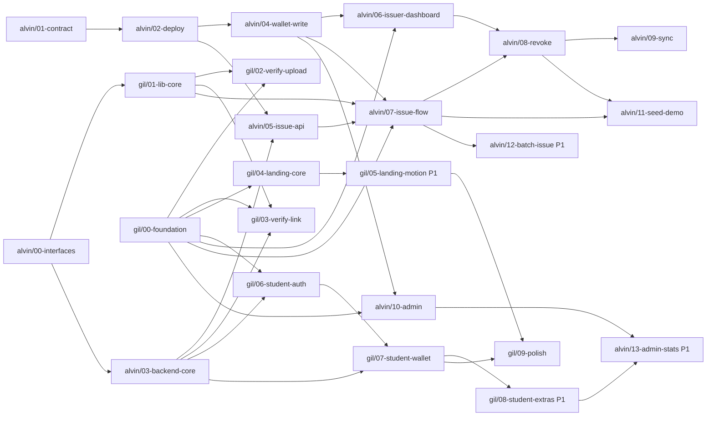

# Workflow: smart contract, issuer flow and admin (Alvin)

| | |
|---|---|
| **Integration branch** | `develop` (both devs merge here; released to `main` at each checkpoint) |
| **Alvin's sub-branches** | `alvin/00-interfaces` to `alvin/13-admin-stats` (14 branches, section 4) |
| **Owner** | Alvin |
| **Reviewer** | Gil |
| **Pairs with** | `pr-gil.md` (design foundation, landing, verify, student) |
| **Project** | CampusCred: academic credentials as soulbound records on BNB Smart Chain (testnet), verified in seconds by anyone |
| **Team** | Conexus, Batangas State University |

## 1. Goal and scope

Ship the trusted core and everything a **registrar** or **admin** does:

1. The `CampusCred` smart contract on BSC Testnet: issue, revoke, verify, issuer whitelist, pause, no transfer.
2. The Supabase backend (schema, row-level security, private PDF storage, seed data) and the issuer and admin API routes.
3. MetaMask wallet connection and the chain **write** helpers.
4. The issuer dashboard, the issue flow, credential detail with revoke, and the admin page.

An authorized issuer can issue a credential recorded on BSC Testnet in one transaction, and can revoke it with a reason. The revocation shows up on verification immediately. **No personal data is ever written on chain.**

The contract comes first: a contract bug cannot be patched after deployment, and Gil's verify screens depend on its address and ABI.

### Branches at a glance

| Branch | Delivers | Priority | Checkpoint | Depends on |
|---|---|---|---|---|
| `alvin/00-interfaces` | `develop` and branch protection, CI, PR template, contract and Supabase stubs, env template | P0 | CP1 | nothing |
| `alvin/01-contract` | `CampusCred.sol` and its tests | P0 | CP2 | nothing |
| `alvin/02-deploy` | Deploy, BscScan verify, ABI export, hand-issued credential | P0 | CP2 | `alvin/01` |
| `alvin/03-backend-core` | Migration, RLS, bucket, server helpers, seeded students | P0 | CP2 | `alvin/00` |
| `alvin/04-wallet-write` | MetaMask hook, chain write helpers, error mapping, role gates | P0 | CP3 | `alvin/02`, `gil/00` |
| `alvin/05-issue-api` | `prepare`, `confirm`, student search, issuers list | P0 | CP3 | `alvin/02`, `alvin/03` |
| `alvin/06-issuer-dashboard` | `/issuer` and its list endpoints | P0 | CP3 | `alvin/04`, `gil/00` |
| `alvin/07-issue-flow` | `/issuer/new` end to end | P0 | CP3 | `alvin/04`, `alvin/05`, `gil/00`, `gil/01` |
| `alvin/08-revoke` | Credential detail and revoke | P0 | CP4 | `alvin/06`, `alvin/07` |
| `alvin/09-sync` | Event sync into Supabase | P0 | CP4 | `alvin/05`, `alvin/08` |
| `alvin/10-admin` | `/admin`: issuers and pause | P0 | CP5 | `alvin/04`, `gil/00` |
| `alvin/11-seed-demo` | Demo data, sample PDFs, README, backup video | P0 | CP5 | `alvin/07`, `alvin/08` |
| `alvin/12-batch-issue` | CSV and ZIP batch issue | P1 | CP5 | `alvin/07` |
| `alvin/13-admin-stats` | Admin counts | P1 | CP5 | `alvin/10`, `gil/08` |

**In scope:** the branches above and the routes and paths Alvin owns in 3.3 and 3.4, including `hardhat/`, `supabase/`, `scripts/` and `.github/`.

**Out of scope (do not build):**

- Landing, verify screens, student pages and student login: all in `pr-gil.md`.
- Design tokens, the app shell and shared components: Gil builds them in `gil/00`. Use them as they land; do not restyle.
- Real student information system integration, mainnet, real registrar accounts.
- ERC-721 or ERC-5192 tokens, re-issue, student wallet claiming (future work).
- OCR pre-fill (FR-14): optional stretch only.

## 2. Branching workflow

Nobody works on one long branch. Work is cut into **small sub-branches** (one topic each) that merge into a shared `develop` branch, and `develop` is released to `main` at each checkpoint. This keeps both devs unblocked and every review small.

### 2.1 Branch model

```
main                          demo-ready, protected. Only release PRs merge here.
 └── develop                  integration branch. Every sub-branch merges here.
      │
      ├── gil/00-foundation          alvin/00-interfaces
      ├── gil/01-lib-core            alvin/01-contract
      ├── gil/02-verify-upload       alvin/02-deploy
      ├── gil/03-verify-link         alvin/03-backend-core
      ├── gil/04-landing-core        alvin/04-wallet-write
      ├── gil/05-landing-motion      alvin/05-issue-api
      ├── gil/06-student-auth        alvin/06-issuer-dashboard
      ├── gil/07-student-wallet      alvin/07-issue-flow
      ├── gil/08-student-extras      alvin/08-revoke
      └── gil/09-polish              alvin/09-sync
                                     alvin/10-admin
                                     alvin/11-seed-demo
                                     alvin/12-batch-issue      (P1)
                                     alvin/13-admin-stats      (P1)
```

| Branch | Purpose | Who merges | How |
|---|---|---|---|
| `main` | What is deployed for the demo. Always works. | Release PR only | Merge commit, then tag (`cp2`, `cp3`, `cp4`, `demo`) |
| `develop` | Integration. The latest work from both devs. | Sub-branch PRs | **Squash merge**, branch deleted after |
| `gil/NN-slug`, `alvin/NN-slug` | One task each, cut from `develop` | The owner, after approval | Opened as a PR into `develop` |
| `hotfix/slug` | Urgent fix after the freeze | Either dev | PR into `main`, then merge `main` back into `develop` |

Rules:

- **No direct pushes** to `main` or `develop`. Turn on branch protection: PR required, one approval, checks must pass.
- **Sub-branch = one topic and a few hours of work.** Aim for under about 400 changed lines, not counting generated files (`bun.lock`, the exported ABI).
- **Name:** `<dev>/<NN>-<slug>`. `NN` is the order in your list. Never reuse a number. The branch cards in section 4 are the master list.
- **Base:** `develop`, unless a card says it is stacked on another branch (see 2.3).
- **Review:** the *other* dev approves. Gil reviews visuals, copy and accessibility. Alvin reviews contract, security and data. Review within the same checkpoint; if a review blocks you for more than 30 minutes, ping in chat.
- **Checks before you ask for review:** `bun run lint`, `bunx tsc --noEmit`, `bun test`, `bun run build`. Contract branches also run `npx hardhat test` inside `hardhat/`.
- **Commits:** small, one topic, clear message (`feat(verify): ...`, `fix(shell): ...`, `chore(ci): ...`). They are squashed on merge, so the PR title becomes the final message: write it well.
- **Draft early.** Open the PR as a Draft on your first push so the other dev can see progress.

### 2.2 Day-to-day commands

```bash
# 1. Start a sub-branch from the latest develop
git switch develop && git pull
git switch -c gil/02-verify-upload

# 2. Work, commit small, push, open a Draft PR into develop
git push -u origin gil/02-verify-upload
gh pr create --base develop --draft --title "feat(verify): upload verify page"   # or use the GitHub UI

# 3. Keep it current: rebase on develop, do not merge develop into your branch
git fetch origin && git rebase origin/develop
#    bun.lock conflict? take develop's file and regenerate it:
git checkout origin/develop -- bun.lock && bun install && git add bun.lock && git rebase --continue

# 4. When green: mark ready, get the other dev's approval, squash merge, delete the branch
git switch develop && git pull && git branch -d gil/02-verify-upload
```

### 2.3 When you depend on a branch that is not merged yet

Pick the first option that works:

1. **Use the stub.** The seams in 3.4 all ship with a working stub or mock (`USE_MOCK_CHAIN`, config placeholders). Build against those.
2. **Wait.** If the dependency is small and due soon (the graph in 2.4 shows what is next), do another card meanwhile.
3. **Stack on it.** Cut your branch from theirs and set your PR's base to theirs. When theirs is squash-merged, move yours onto `develop`:

```bash
git switch -c alvin/07-issue-flow gil/00-foundation        # stacked on an unmerged branch
# ... later, after gil/00-foundation is squash-merged into develop:
git fetch origin
git rebase --onto origin/develop gil/00-foundation alvin/07-issue-flow
git push --force-with-lease
# then change the PR base from gil/00-foundation to develop
```

Never edit the other dev's files to get unblocked (3.3). Ask them, or use a stub.

### 2.4 Dependency graph

An arrow means "must be merged into `develop` first". Green-field branches with no incoming arrow can start immediately.



### 2.5 Merge schedule by checkpoint

How many hours the on-site build lasts is still an open question. Treat checkpoints as ordered milestones and cut from the bottom if time runs short. **Phases 1 to 4 alone make a full demo.**

| # | Milestone | Merge into `develop` | Release to `main` | What works after |
|---|---|---|---|---|
| CP0 | Kickoff (15 min) | Create `develop`, turn on branch protection | | Branches exist, both devs have read this doc |
| CP1 | Seams exist | `alvin/00-interfaces`, `gil/00-foundation`, `gil/01-lib-core` | | Both devs can build against stubs and shared components |
| CP2 | **Contract is live** | `alvin/01-contract`, `alvin/02-deploy`, `alvin/03-backend-core`, `gil/02-verify-upload`, `gil/04-landing-core` | `release: cp2` (tag `cp2`) | Real chain reads. Gil sets `NEXT_PUBLIC_USE_MOCK_CHAIN=false`. A hand-issued credential verifies. |
| CP3 | Issue to verify | `alvin/04`, `05`, `06`, `07`, `gil/03-verify-link` | `release: cp3` | A credential issued in the app shows a real Valid on `/v/[slug]` |
| CP4 | Revoke and student wallet | `alvin/08-revoke`, `alvin/09-sync`, `gil/06-student-auth`, `gil/07-student-wallet` | `release: cp4` | Revoke shows Revoked at once. Students see credentials with a QR. |
| CP5 | **Freeze** | `alvin/10-admin`, `alvin/11-seed-demo`, `gil/09-polish`, plus P1 branches that are ready (`gil/05`, `gil/08`, `alvin/12`, `alvin/13`) | `release: demo` (tag `demo`) | Demo script runs end to end. After this, only `hotfix/*`. |

Cut line, from the bottom: `alvin/13`, `alvin/12`, `gil/08`, `gil/05`, then `alvin/10` stays (issuer admin is P0), `alvin/09` can be replaced by manual sync calls. Do **not** cut `alvin/01` to `alvin/08` or `gil/00` to `gil/04`.

### 2.6 Release PRs (`develop` to `main`)

- Title `release: cpN`. The dev who owns most of that checkpoint opens it; the other approves.
- Before merging: `bun run build` passes on `develop`, and the checkpoint's "what works" line in 2.5 has been tried by hand on the preview deployment.
- Merge with a **merge commit** (not squash), then tag `cpN`. Vercel deploys `main`.
- Add a pull request template with these headings (`alvin/00-interfaces` adds `.github/pull_request_template.md`): **Branch card** (e.g. `gil/02`), **What changed**, **Screenshots (desktop and 360px)** for UI, **How I tested it**, **Checklist** (checks pass, no secrets, `.env.example` updated, placeholders marked).

### 2.7 Definition of done for any sub-branch

- [ ] Every item in the branch card's **Scope** is checked, or moved to a later card with a note
- [ ] The card's **Done when** line is true and you can show it
- [ ] `bun run lint`, `bunx tsc --noEmit`, `bun test`, `bun run build` pass (and `npx hardhat test` for contract branches)
- [ ] No secrets, salt or private keys in the diff or the client bundle
- [ ] `.env.example` updated if you added a variable
- [ ] UI branches: screenshots at desktop and 360px, keyboard focus visible, status never colour alone, `prefers-reduced-motion` respected
- [ ] You only touched files you own (3.3)
- [ ] The other dev approved; the branch is deleted after the squash merge

## 3. Shared agreements (identical in both PR docs)

Gil and Alvin work in parallel. Everything in this section is the contract between the two PRs. If you need to change it, tell the other dev first and update **both** docs.

### 3.1 Who builds what

| Area | Gil | Alvin |
|---|---|---|
| Design foundation (tokens, fonts, shell, shared components) | Owns | Uses |
| Landing page `/` | Owns | |
| Verify by upload `/verify`, verify by link or QR `/v/[slug]` | Owns | |
| Student login, sign up, wallet `/student` | Owns | |
| Browser hashing, chain **read** client, result decision logic | Owns | |
| Smart contract, tests, deployment, ABI export | | Owns |
| Supabase schema, RLS, storage bucket, seed data | | Owns |
| Wallet connection (MetaMask), chain **write** helpers | | Owns |
| Issuer dashboard, issue flow, credential detail and revoke | | Owns |
| Admin page (issuers, pause, stats) | | Owns |
| Issuer and admin API routes, event sync | | Owns |
| Student and public verify API routes | Owns | |

### 3.2 Repo facts that will bite you

- **Read `AGENTS.md` first.** This is Next.js 16.4 with React 19.3 and the App Router only. APIs differ from older Next.js. Read the relevant guide in `node_modules/next/dist/docs/` before writing Next-specific code (routing, caching, route handlers, cookies).
- `next.config.ts` sets `cacheComponents: true`, so rendering is **dynamic by default** and `"use cache"` is opt-in. Anything that reads cookies, headers or the wallet must be a client component or sit behind `<Suspense>`.
- **Package manager is bun.** Use `bun install`, `bun dev`, `bun run build`, `bun run lint`, `bunx tsc --noEmit`. Never commit `package-lock.json` or `yarn.lock`.
- **Tailwind v4, CSS-first.** Tokens live in `app/globals.css` under `@theme inline`. There is no `tailwind.config` and no `postcss.config`; do not add either.
- shadcn is the `base-nova` style, which is built on **Base UI** (`@base-ui/react`), not Radix. Add components with `bunx shadcn add <name>`.
- No test runner is configured. Use **`bun test`** (built in, no config) for unit tests of pure functions. Contract tests use Hardhat.
- Path alias `@/*` maps to the repo root. The Hardhat project lives in `hardhat/` and is excluded from the root `tsconfig.json`.
- The UI prototype is the visual source of truth: https://claude.ai/artifact/48bvH6qfLBRCSESAyucHjL (Design canvas, 6 screens plus the landing page). Match it; do not redesign. All names, numbers, QR codes, the contract address, the domain and the seminar name in the prototype are **sample data or placeholders**.

### 3.3 Path ownership

Do not edit files in the other dev's paths. Open an issue or ask in chat instead.

| Path | Owner |
|---|---|
| `app/globals.css`, `app/layout.tsx`, `components/ui/**`, `components/brand/**`, `components/shell/**` | Gil |
| `components/landing/**`, `components/verify/**`, `components/student/**` | Gil |
| `app/page.tsx`, `app/verify/**`, `app/v/**`, `app/student/**`, `app/(auth)/**` | Gil |
| `app/api/verify/**`, `app/api/students/**`, `app/api/credentials/[hash]/visibility/**`, `app/api/credentials/[hash]/download-url/**` | Gil |
| `lib/hash.ts`, `lib/format.ts`, `lib/types/**`, `lib/chain/read.ts`, `lib/chain/mock.ts`, `lib/verify/**`, `lib/auth/**` | Gil |
| `app/dev/**` (dev-only component showcase), `docs/FRONTEND.md` | Gil |
| `hardhat/**`, `supabase/**`, `scripts/**`, `.github/**` | Alvin |
| `lib/contract/**`, `lib/chain/write.ts`, `lib/wallet/**`, `lib/supabase/**`, `lib/server/**` | Alvin |
| `components/issuer/**`, `components/admin/**`, `components/wallet/**` | Alvin |
| `app/issuer/**`, `app/admin/**` | Alvin |
| `app/api/credentials/prepare/**`, `app/api/credentials/confirm/**`, `app/api/credentials/batch/**`, `app/api/credentials/[hash]/revoke-confirm/**` | Alvin |
| `app/api/issuers/**`, `app/api/issuer/**`, `app/api/admin/**`, `app/api/sync/**` | Alvin |

**Shared files** (`package.json`, `bun.lock`, `.env.example`, `README.md`, `tsconfig.json`):

- Add dependencies in their own commit with a clear message, then rebase often.
- On a `bun.lock` conflict, take main's version and re-run `bun install`. Never hand-merge it.
- `.env.example` is append-only: each dev adds a block under their own heading.

### 3.4 Interfaces between the two PRs

These files are the seams. The producer ships a working stub early (see 2.4 and 2.5) so the consumer is never blocked.

```ts
// lib/types/credential.ts                                  (gil/01-lib-core)
export type Hex = `0x${string}`;
export type CredType =
  | "CERT_ENROLLMENT" | "CERT_GRADES" | "CERT_COMPLETION"
  | "CERT_GOOD_MORAL" | "CERT_SEMINAR" | "DIPLOMA" | "TRANSCRIPT";
export type RevokeReason = "ISSUED_IN_ERROR" | "WRONG_DETAILS" | "REPLACED" | "FRAUD";
export type VerifyResultKind = "valid" | "revoked" | "tampered" | "not_found";

export interface ChainRecord {
  docHash: Hex;
  status: "none" | "active" | "revoked";
  studentRef: Hex;
  credType: CredType | "UNKNOWN";   // decoded with decodeCredType()
  issuer: Hex;
  issuedAt: number | null;          // unix seconds
  revokedAt: number | null;
  revokeReason: RevokeReason | null; // decoded with decodeReason()
}

// lib/hash.ts                                              (gil/01-lib-core)
export function sha256Hex(file: Blob): Promise<Hex>;  // crypto.subtle, "0x" + 64 hex chars

// lib/chain/read.ts                                        (gil/01-lib-core)
// Read-only provider with fallback RPCs. No wallet needed. Honors NEXT_PUBLIC_USE_MOCK_CHAIN.
export function readChainRecord(docHash: Hex): Promise<ChainRecord>;

// lib/verify/decide-result.ts                              (gil/01-lib-core)
export function decideResult(input: {
  record: ChainRecord;
  openedViaSlug: boolean;
  slugDocHash?: Hex;      // hash stored for the slug (from /api/verify/[slug])
  uploadedDocHash?: Hex;
}): VerifyResultKind;

// lib/contract/config.ts                   (alvin/00-interfaces stub, real address in alvin/02-deploy)
export const CHAIN_ID: 97;
export const CONTRACT_ADDRESS: Hex;       // placeholder until deployed (CP2)
export const RPC_URLS: string[];          // primary + fallback
export const EXPLORER_URL: "https://testnet.bscscan.com";
export const txUrl: (hash: Hex) => string;
// lib/contract/CampusCred.abi.ts           (alvin/00 stub, alvin/02 real)  export const CAMPUSCRED_ABI = [...] as const;
// lib/contract/codes.ts                    (alvin/00-interfaces)  decodeCredType(bytes32), encodeCredType(code),
//                                                    decodeReason(bytes32), encodeReason(code)

// lib/supabase/{browser,server,admin}.ts   (alvin/00-interfaces) clients for @supabase/ssr
// lib/server/student-ref.ts                (alvin/03-backend-core) studentRef(studentNo), server only
```

**HTTP endpoints.** Responses are JSON. Errors are `{ "error": "<code>" }` with a matching status.

| Method and path | Owner | Auth | Request, response |
|---|---|---|---|
| `GET /api/verify/[slug]` | Gil | none | `{ docHash, credType, title, issuerName, issuerWallet, issuedAt, txUrl }`. `404 not_found` if the slug is unknown **or** the credential is not public. Never returns a student name. |
| `POST /api/verify/log` | Gil (P1) | none | `{ docHash, result, method }`. Writes to `verifications`. Stores no IP or personal data. The verify result itself is computed in the browser; this only records it. |
| `GET /api/students/me/credentials` | Gil | student session | `[{ docHash, slug, credType, title, issuerName, issuedAt, status, issueTx, revokeTx?, revokeReason?, isPublic }]` |
| `POST /api/credentials/[hash]/download-url` | Gil | student session | `{ url, expiresAt }`. Signed URL that expires after **60 seconds**. Only the owner can request it. *(Added to the spec: needed for the 60-second download.)* |
| `PATCH /api/credentials/[hash]/visibility` | Gil (P1) | student session | `{ isPublic }` |
| `POST /api/credentials/prepare` | Alvin | wallet signature | multipart: `file`, `studentNo`, `credType`, `title`, `docHash`. Server re-hashes the file and rejects a mismatch. Returns `{ docHash, studentRef, credType32, pdfPath }`. |
| `POST /api/credentials/confirm` | Alvin | wallet signature | `{ docHash, txHash, title }`. Server reads the receipt and the `CredentialIssued` event before saving; the signer must be the event's issuer. Returns `{ slug, txUrl }`. *(`title` added to the spec: it is not on chain and the row needs it.)* |
| `POST /api/credentials/[hash]/revoke-confirm` | Alvin | wallet signature | `{ txHash, reason }`. Server verifies the `CredentialRevoked` event. |
| `GET /api/issuer/students?q=` | Alvin | wallet signature | Student search for the issue form. Issuer-only; this is the only place names are returned to a non-owner. *(Added to the spec.)* |
| `GET /api/issuer/credentials` and `GET /api/issuer/credentials/[hash]` | Alvin | wallet signature | The issuing wallet's credentials (admin sees all) with student name and number, and one record. Issuer or admin only. *(Added to the spec: the dashboard and detail page need them.)* |
| `GET /api/issuers` | Alvin | none | `[{ wallet, displayName, active }]` for the verify page |
| `GET /api/admin/stats` | Alvin (P1) | wallet signature (admin) | `{ issued, verified, revoked }` |
| `POST /api/sync` | Alvin | secret header | Mirrors contract events into Supabase. Idempotent. *(Added to the spec: see `alvin/09-sync`.)* |

**Wallet signature auth.** The client signs a message `CampusCred auth\nnonce: <random>\nissued: <ISO time>` with `personal_sign`. It sends the address, message and signature as headers. The server recovers the signer, rejects messages older than 5 minutes, and checks the address holds the needed role. The helper is `lib/server/wallet-auth.ts` (Alvin).

### 3.5 Environment variables

`.env.example` must list all of these. Only `NEXT_PUBLIC_*` values may reach the browser.

| Variable | Used by | Notes |
|---|---|---|
| `NEXT_PUBLIC_SITE_URL` | both | Share links are `${SITE_URL}/v/${slug}` |
| `NEXT_PUBLIC_CHAIN_ID` | both | `97` (BSC Testnet) |
| `NEXT_PUBLIC_RPC_URL_PRIMARY`, `NEXT_PUBLIC_RPC_URL_FALLBACK` | both | Two different public BSC Testnet RPCs |
| `NEXT_PUBLIC_CONTRACT_ADDRESS` | both | Filled at CP2 |
| `NEXT_PUBLIC_USE_MOCK_CHAIN` | Gil | `true` until CP2 |
| `NEXT_PUBLIC_SUPABASE_URL`, `NEXT_PUBLIC_SUPABASE_ANON_KEY` | both | |
| `SUPABASE_SERVICE_ROLE_KEY` | server only | Never in client code |
| `STUDENT_REF_SALT` | server only | **Never** in the frontend bundle or the repo |
| `SYNC_SECRET` | Alvin | Protects `/api/sync` |
| `DEPLOYER_PRIVATE_KEY`, `BSCSCAN_API_KEY` | `hardhat/` only | **Testnet key only. Never a mainnet key.** |

`.env*` stays in `.gitignore`. Share real values over a private channel, not in the PR.

### 3.6 Codes

- **Credential types** (stored on chain as `keccak256(code)`; the UI decodes by lookup in `lib/contract/codes.ts`): `CERT_ENROLLMENT`, `CERT_GRADES`, `CERT_COMPLETION`, `CERT_GOOD_MORAL`, `CERT_SEMINAR`, `DIPLOMA`, `TRANSCRIPT`. The last two are added to the spec's list because the product concept covers diplomas and transcripts. The Supabase `cred_type` column must allow all seven.
- **Revoke reasons** (stored as a `bytes32` short code, decoded back to a string): `ISSUED_IN_ERROR` "Issued in error", `WRONG_DETAILS` "Wrong details", `REPLACED` "Replaced by a corrected credential", `FRAUD` "Fraud".
- **Student reference:** `studentRef = keccak256(toUtf8Bytes(STUDENT_REF_SALT + ":" + studentNo))`. One function, `lib/server/student-ref.ts`, used by `prepare` and by the seed script. Never computed in the browser.
- **Document hash:** SHA-256 over the exact PDF bytes, written as `0x` plus 64 hex characters. It is the contract's mapping key.

### 3.7 Verify result rules

The decision lives in one pure function, `decideResult`, so it is easy to test.

1. **Opened through a share link or QR** (`/v/[slug]`) and a PDF is then uploaded:
   - the uploaded hash is **different** from the slug's stored hash → `tampered`;
   - the hashes are equal → the chain status of that hash decides (`valid` or `revoked`).
2. **Bare upload** on `/verify` (no slug):
   - chain says Revoked → `revoked`; Active → `valid`; None → `not_found`.
   - It can **never** say `tampered`: a hash alone cannot tell an edited file from an unknown one. The Not found message must point the verifier to the QR code or link.
3. An unknown or private slug shows Not found.

*(Clarification of the spec: in a slug context a mismatch is always Tampered, even if the other file happens to be a real credential.)*

### 3.8 Privacy rules (non-negotiable)

- On chain: document hash, salted student reference, credential type, issuer wallet, timestamps, status, revoke reason code. **Nothing else.**
- The verify page and `/api/verify/*` never return a student name, number or email.
- PDFs live in a private Supabase bucket. Downloads use signed URLs that expire after 60 seconds.
- A PDF chosen on the verify page is hashed in the browser and never uploaded.
- Demo data is sample data only: no real student records.

## 4. Alvin's sub-branches

Each card is one branch and one PR into `develop`. Do them in order unless the graph in 2.4 lets you start one earlier. Priority: **P0** must work in the on-site demo, **P1** build if time allows. "Artboard" names refer to the prototype canvas. The contract spec is in section 5, the data model in section 6, tests in section 8.

#### `alvin/00-interfaces`

| | |
|---|---|
| **Depends on** | nothing |
| **Unblocks** | `gil/01`, `alvin/03` |
| **Priority · checkpoint** | P0 · CP1 (first 30 to 45 minutes; keep it tiny) |

Scope:

- [ ] At CP0: create `develop` from `main` and turn on branch protection for `main` and `develop` (2.1)
- [ ] `.github/workflows/ci.yml` (bun install, lint, `tsc --noEmit`, `bun test`, build) and `.github/pull_request_template.md` (2.6)
- [ ] Install `@supabase/supabase-js` and `@supabase/ssr` in their own commit
- [ ] `lib/contract/config.ts` (placeholder address, chain 97, RPC URLs from env, explorer URL, `txUrl`), `lib/contract/codes.ts` (credential types hashed with `keccak256`, reasons as `bytes32` strings, both directions), `lib/contract/CampusCred.abi.ts` (hand-written stub with the function, event and error signatures from section 5, so Gil can compile)
- [ ] `lib/supabase/browser.ts`, `server.ts`, `admin.ts` (clients only; `cookies()` is async in this Next version)
- [ ] `.env.example` with every shared variable from 3.5 and a comment for each

Files: `.github/**`, `lib/contract/**`, `lib/supabase/**`, `.env.example`, `package.json`.
Tests: `bun test` for `codes.ts` (types and reasons round-trip; an unknown `bytes32` decodes to `UNKNOWN`).
**Done when:** Gil can import the config, codes and ABI; CI is green on `develop`; the PR template shows on new PRs.

#### `alvin/01-contract`

| | |
|---|---|
| **Depends on** | nothing |
| **Unblocks** | `alvin/02` |
| **Priority · checkpoint** | P0 · CP2 (start right after `alvin/00`) |

A contract bug cannot be patched after deployment, so this branch is tests first.

- [ ] Create `hardhat/` with its own `package.json`: `hardhat`, `@nomicfoundation/hardhat-toolbox` (Chai), `@nomicfoundation/hardhat-verify`, `@openzeppelin/contracts@^5`. Exclude `hardhat/` from the root `tsconfig.json`
- [ ] `hardhat.config.ts`: Solidity `0.8.24`, `evmVersion: "paris"`, network `bscTestnet` (chain 97)
- [ ] `hardhat/contracts/CampusCred.sol` per section 5
- [ ] All unit tests in section 8 ("Contract unit tests"), green

Files: `hardhat/**`.
Tests: `npx hardhat test` inside `hardhat/`, every case in section 8.
**Done when:** all contract tests pass, including the "no transfer or approve in the ABI" test (FR-10).

#### `alvin/02-deploy`

| | |
|---|---|
| **Depends on** | `alvin/01` |
| **Unblocks** | `alvin/04`, `alvin/05`, and Gil turning the mock chain off |
| **Priority · checkpoint** | P0 · CP2 (this triggers `release: cp2`) |

- [ ] `hardhat/scripts/deploy.ts`: takes the admin address (the registrar head's MetaMask wallet) as the constructor argument and prints the contract address
- [ ] Deploy to BSC Testnet and **verify the source on BscScan** with `@nomicfoundation/hardhat-verify` (BscScan sits behind the Etherscan v2 API; check the plugin's current docs for the config)
- [ ] `hardhat/scripts/export-abi.ts` writes `lib/contract/CampusCred.abi.ts`; put the real address in `lib/contract/config.ts` and `.env.example`
- [ ] `hardhat/scripts/hand-issue.ts`: issues one credential from a funded issuer wallet and prints its document hash
- [ ] Fund 2 or 3 wallets with faucet test BNB (admin, issuer, one spare)
- [ ] Message Gil the address and the hand-issued hash

Files: `hardhat/scripts/**`, `lib/contract/**`, `.env.example`.
Tests: run `hand-issue.ts` and check the `CredentialIssued` event on BscScan.
**Done when:** the source is verified on BscScan and Gil's `readChainRecord` returns the hand-issued credential with the mock flag off.

#### `alvin/03-backend-core`

| | |
|---|---|
| **Depends on** | `alvin/00` |
| **Unblocks** | `alvin/05`, `gil/03`, `gil/06`, `gil/07` |
| **Priority · checkpoint** | P0 · CP2 |

- [ ] `supabase/migrations/0001_init.sql` with the tables and row-level security in section 6, and the private `credentials` storage bucket
- [ ] `lib/server/student-ref.ts`: `studentRef(studentNo)` per 3.6; throws if `STUDENT_REF_SALT` is missing
- [ ] `lib/server/wallet-auth.ts`: verifies the signed headers (3.4), enforces the 5-minute window, returns the address, and offers `requireIssuer` and `requireAdmin` using an on-chain `hasRole` read
- [ ] `lib/server/chain.ts`: server-side read provider with receipt and event checks for `confirm` and `revoke-confirm`
- [ ] `scripts/seed-students.ts`: 3 sample students (Supabase auth users with known demo passwords, plus `students` rows with `studentRef`) and the issuer row for the demo issuer wallet. Sample data only
- [ ] Send Gil the demo student emails and password privately

Files: `supabase/**`, `lib/server/**`, `scripts/seed-students.ts`.
Tests (`bun test`): `studentRef` (same input same output; different salt different output; missing salt throws); `wallet-auth` (valid signature accepted; wrong signer, message older than 5 minutes, and address without the role rejected).
**Done when:** the migration applies cleanly, the seeded students can sign in, and a student cannot read another student's rows.

#### `alvin/04-wallet-write`

| | |
|---|---|
| **Depends on** | `alvin/02` (ABI), `gil/00` (components for the gate screens) |
| **Unblocks** | `alvin/06`, `alvin/07`, `alvin/10` |
| **Priority · checkpoint** | P0 · CP3 |

- [ ] `lib/wallet/use-wallet.ts`: connect through `window.ethereum` and `BrowserProvider`; ensure chain 97 (`wallet_switchEthereumChain`, falling back to `wallet_addEthereumChain` with BSC Testnet details); listen for account and chain changes; expose `address`, `isIssuer`, `isAdmin` (`hasRole` reads), `signAuthHeaders()`
- [ ] `lib/chain/write.ts`: `issueCredential`, `revokeCredential`, `addIssuer`, `removeIssuer`, `pause`, `unpause`, plus `mapContractError(e)`:
  - `AlreadyIssued` becomes "This document was already issued."
  - `NotAllowed` becomes "This wallet is not allowed to do that."
  - `EmptyHash` becomes "Choose a PDF first."
  - `EnforcedPause` becomes "Issuing is paused by the admin."
  - a rejected signature (code `4001` or `ACTION_REJECTED`) becomes "You cancelled the request in MetaMask. Nothing was issued."
- [ ] `components/wallet/connect-gate.tsx` and `role-gate.tsx`. Not connected shows "Connect MetaMask". Connected but wrong role shows "This wallet is not an approved issuer. Ask the registrar admin to add it." (or the admin equivalent)

Files: `lib/wallet/**`, `lib/chain/write.ts`, `components/wallet/**`.
Tests (`bun test`): `mapContractError` returns the message above for each custom error and for a rejected signature. Manual: connect, switch network, change account.
**Done when:** a page wrapped in `RoleGate` is visible only to a wallet holding the role.

#### `alvin/05-issue-api`

| | |
|---|---|
| **Depends on** | `alvin/02`, `alvin/03` |
| **Unblocks** | `alvin/07` |
| **Priority · checkpoint** | P0 · CP3 |

- [ ] `POST /api/credentials/prepare`: validates the wallet signature and issuer role; checks the file is a PDF (`%PDF` header, 10 MB max); **re-computes SHA-256 on the server and rejects a mismatch with the client's hash**; uploads to the private bucket; returns `{ docHash, studentRef, credType32, pdfPath }`
- [ ] `POST /api/credentials/confirm`: **never trust the client.** Read the receipt and the `CredentialIssued` event from the chain, check `docHash`, `studentRef` and `issuer` match, then insert the `credentials` row with a fresh 10-character `share_slug` and return `{ slug, txUrl }`. Idempotent for the same `txHash`
- [ ] `GET /api/issuer/students?q=`: issuer-only student search (name and number)
- [ ] `GET /api/issuers`: public list of display names and active flags

Files: `app/api/credentials/prepare/**`, `app/api/credentials/confirm/**`, `app/api/issuer/students/**`, `app/api/issuers/**`.
Tests: manual with `curl` or a small script: wrong signature rejected; non-issuer rejected; tampered file hash rejected; confirming the same transaction twice creates one row.
**Done when:** with a real transaction hash, `confirm` returns a slug and the row exists with the right status.

#### `alvin/06-issuer-dashboard`

| | |
|---|---|
| **Depends on** | `alvin/04`, `gil/00` |
| **Unblocks** | `alvin/08` |
| **Priority · checkpoint** | P0 · CP3 |

Artboard "6 · Issuer dashboard", route `/issuer`.

- [ ] `GET /api/issuer/credentials` (the issuing wallet's credentials; admin sees all) and `GET /api/issuer/credentials/[hash]` (one record with student name and number; issuer or admin only). Added to the spec
- [ ] `app/issuer/layout.tsx` with `AppShell` (nav Dashboard, Issue credential, Verify a document) wrapped in the connect and role gates
- [ ] `/issuer` page: `PageBanner` "Issued credentials" with an "Issue new" button; `TabsPill` All / Active / Revoked; table (credential, student with number, issued date, status pill, transaction link to BscScan); "Your wallet" card (address, network, role). Rows link to `/issuer/credential/[hash]`

Files: `app/issuer/layout.tsx`, `app/issuer/page.tsx`, `components/issuer/**`, `app/api/issuer/credentials/**`.
Tests: manual. Not connected, wrong role, empty list and a populated list each look right.
**Done when:** a connected issuer sees their credentials with correct status pills.

#### `alvin/07-issue-flow`

| | |
|---|---|
| **Depends on** | `alvin/04`, `alvin/05`, `gil/00`, `gil/01` |
| **Unblocks** | `alvin/08`, `alvin/11`, `alvin/12`, `gil/03` real data |
| **Priority · checkpoint** | P0 · CP3 |

Artboard "4 · Issue credential", route `/issuer/new`.

- [ ] Form: student search (`/api/issuer/students`), credential type select (seven types, 3.6), title input (default like "Certificate of Enrollment, 1st Sem AY 2026–2027"), Gil's `DropZone`. After a file is chosen, show the fingerprint (scrambling `HashText`) from `sha256Hex`. **Sign and issue** stays disabled until student, type, title and file are all set
- [ ] Sequence and the black status pill (it changes width per step): **Uploading** (`prepare`), **Waiting for wallet** (`issueCredential`), **Confirming** (wait for the receipt), **Done** (`confirm`). Show the matching progress tracker
- [ ] Map every failure to a friendly message from `mapContractError`; leave a retry that works, no stuck spinner
- [ ] Success card: "Issued on BSC Testnet.", `QrTile` for the share link, the link `${SITE_URL}/v/${slug}`, BscScan transaction link (FR-04), **Issue another**, **Back to dashboard**
- [ ] Click to confirmed in under **15 seconds** on BSC Testnet (NFR-02)

Files: `app/issuer/new/**`, `components/issuer/**`.
Tests: manual. Issue from the app and check the BscScan event; reject the MetaMask popup at each step; try a duplicate file (friendly "already issued").
**Done when:** AC-1 passes: a transaction link appears and BscScan shows `CredentialIssued`.

#### `alvin/08-revoke`

| | |
|---|---|
| **Depends on** | `alvin/06`, `alvin/07` |
| **Unblocks** | `alvin/09`, `alvin/11`, AC-5 |
| **Priority · checkpoint** | P0 · CP4 |

No prototype screen. Compose from the shared components in the same style as the dashboard; Gil reviews the visuals.

- [ ] `/issuer/credential/[hash]`: `PageBanner` with the title and status pill; a `Card` with student, type, issued date, issuer, fingerprint and BscScan link; `Timeline` (Issued, and Revoked when applicable)
- [ ] **Revoke** button (visible to the issuing wallet and to admin) opens a dialog with the reason select (Issued in error, Wrong details, Replaced, Fraud; 3.6) and a confirm button. Flow: `revokeCredential` in MetaMask, wait for the receipt, `POST /api/credentials/[hash]/revoke-confirm`, then show the Revoked state
- [ ] `revoke-confirm` reads the `CredentialRevoked` event from the chain, then updates `status`, `revoke_tx`, `revoke_reason`, `revoked_at`
- [ ] Hide or disable Revoke for an already revoked credential and for wallets that are not allowed

Files: `app/issuer/credential/**`, `components/issuer/**`, `app/api/credentials/[hash]/revoke-confirm/**`.
Tests: manual. Revoke, then open Gil's `/v/[slug]` and see Revoked with the reason at once; try to revoke twice; try with a different issuer wallet.
**Done when:** AC-5 passes end to end with Gil's verify screen.

#### `alvin/09-sync`

| | |
|---|---|
| **Depends on** | `alvin/05`, `alvin/08` |
| **Unblocks** | `alvin/10`, `alvin/13` |
| **Priority · checkpoint** | P0 · CP4 |

The chain is the source of truth for existence and status; the database only mirrors it.

- [ ] `POST /api/sync` (protected by `SYNC_SECRET`): read `CredentialIssued`, `CredentialRevoked`, `IssuerAdded` and `IssuerRemoved` logs from `sync_state.last_block + 1` to the latest block, in chunks (public RPCs limit `eth_getLogs` ranges), upsert by `doc_hash` or `wallet`, advance `last_block`. Idempotent
- [ ] Also call the sync after `confirm`, `revoke-confirm` and admin actions so the dashboard is current without a cron
- [ ] Skip, with a logged warning, events for credentials that have no database row
- [ ] P1: a Vercel Cron entry calling `/api/sync` every minute

Files: `app/api/sync/**`, small additions to your own `confirm` and `revoke-confirm` routes.
Tests: run the sync twice (no duplicates); revoke from BscScan's write UI or a script, run the sync, and see the row flip to revoked.
**Done when:** a revocation made outside the app shows up in the database after one sync call.

#### `alvin/10-admin`

| | |
|---|---|
| **Depends on** | `alvin/04`, `gil/00` |
| **Unblocks** | `alvin/13` |
| **Priority · checkpoint** | P0 · CP5 |

No prototype screen. Compose from the shared components; Gil reviews the visuals.

- [ ] `/admin`, gated on the admin role. `PageBanner` "Admin"
- [ ] Card **Approved issuers**: table (display name, wallet, status) from `GET /api/issuers`; **Add issuer** form (wallet address checked with `isAddress`, display name) calling `addIssuer`; **Remove** with a confirm calling `removeIssuer`
- [ ] Card **Emergency pause**: switch calling `pause` or `unpause`, with the plain explanation "Pausing stops new issuing and revoking. Verification keeps working."
- [ ] Call the sync after each action

Files: `app/admin/**`, `components/admin/**`.
Tests: manual. Add an issuer and issue from that wallet; remove it and see the friendly "not allowed" message; pause and see the "paused" message while verification still works.
**Done when:** FR-01 passes (admin can add and remove issuer wallets) and the pause switch works.

#### `alvin/11-seed-demo`

| | |
|---|---|
| **Depends on** | `alvin/07`, `alvin/08` |
| **Unblocks** | the demo |
| **Priority · checkpoint** | P0 · CP5 |

- [ ] `scripts/seed-credentials.ts`: issue three sample PDFs for the sample students on the testnet (one gets revoked live in the demo). Sample data only
- [ ] `scripts/sample-pdfs/`: an original PDF and a copy with one letter changed, so Tampered can be shown live
- [ ] `README.md`: how to deploy the contract, run the migration, seed, and run the app
- [ ] Pre-connect MetaMask and pre-select BSC Testnet before going on stage; rehearse the five-minute script twice; record the backup video

Files: `scripts/**`, `README.md`.
Tests: run the whole demo script on the deployed `main`.
**Done when:** a fresh clone plus the README reproduces the demo data, and the backup video exists.

#### `alvin/12-batch-issue` (P1)

| | |
|---|---|
| **Depends on** | `alvin/07` (the contract's `issueBatch` is already in `alvin/01`) |
| **Priority · checkpoint** | P1 · CP5 |

- [ ] CSV (`student_no,title`) plus a ZIP of PDFs named by student number. The browser hashes every PDF and matches rows; mismatches are listed before signing
- [ ] Rows go in chunks of up to 50 to `issueBatch`, one signature per chunk
- [ ] Results table: each row issued or failed, with transaction links
- [ ] `POST /api/credentials/batch` returns the arrays

Files: `app/issuer/batch/**`, `app/api/credentials/batch/**`, `components/issuer/**`.
**Done when:** a seminar's worth of certificates issues in a few signatures (FR-11).

#### `alvin/13-admin-stats` (P1)

| | |
|---|---|
| **Depends on** | `alvin/10`, `gil/08` (verification log) |
| **Priority · checkpoint** | P1 · CP5 |

- [ ] `GET /api/admin/stats` returns `{ issued, verified, revoked }` from `credentials` and `verifications`
- [ ] Stats cards on `/admin` (FR-13)

Files: `app/api/admin/stats/**`, `components/admin/**`.
**Done when:** the three counts appear on `/admin` and change after an issue, a verify and a revoke.

## 5. Reference: smart contract specification

One contract, `hardhat/contracts/CampusCred.sol`, Solidity `^0.8.24`, built on OpenZeppelin **v5** `AccessControl` and `Pausable`. It stores one small record per credential, keyed by the document hash.

### 5.1 Storage and shape

```solidity
// SPDX-License-Identifier: MIT
pragma solidity ^0.8.24;

import {AccessControl} from "@openzeppelin/contracts/access/AccessControl.sol";
import {Pausable} from "@openzeppelin/contracts/utils/Pausable.sol";

contract CampusCred is AccessControl, Pausable {
    bytes32 public constant ISSUER_ROLE = keccak256("ISSUER_ROLE");

    enum Status { None, Active, Revoked }

    struct Credential {
        bytes32 studentRef;    // salted hash, never the raw student number
        bytes32 credType;      // keccak256("CERT_ENROLLMENT") etc.
        address issuer;
        uint64  issuedAt;
        uint64  revokedAt;
        Status  status;
        bytes32 revokeReason;  // short code, e.g. "ISSUED_IN_ERROR"
    }

    mapping(bytes32 => Credential) private credentials;  // docHash => record
    mapping(address => string)     public  issuerName;

    event CredentialIssued(bytes32 indexed docHash, bytes32 indexed studentRef, bytes32 credType, address indexed issuer);
    event CredentialRevoked(bytes32 indexed docHash, bytes32 reason, address indexed by);
    event IssuerAdded(address indexed wallet, string name);
    event IssuerRemoved(address indexed wallet);

    error AlreadyIssued(bytes32 docHash);
    error NotFound(bytes32 docHash);
    error AlreadyRevoked(bytes32 docHash);
    error NotAllowed();
    error EmptyHash();
    error BatchTooLarge(uint256 size);
    error LengthMismatch();

    constructor(address admin) { _grantRole(DEFAULT_ADMIN_ROLE, admin); }
    // ... functions below
}
```

### 5.2 Functions

| Function | Access | Behavior | Reverts when |
|---|---|---|---|
| `addIssuer(address wallet, string name)` | Admin | Grants `ISSUER_ROLE`, stores the display name, emits `IssuerAdded` | Caller is not admin |
| `removeIssuer(address wallet)` | Admin | Revokes `ISSUER_ROLE`, emits `IssuerRemoved`. **Keep the stored name** so past credentials still show their issuer. Past credentials stay Active. | Caller is not admin |
| `issueCredential(bytes32 docHash, bytes32 studentRef, bytes32 credType)` | Issuer | Stores a new Active record, emits `CredentialIssued` | Paused (`EnforcedPause`), `NotAllowed`, `EmptyHash`, `AlreadyIssued` |
| `issueBatch(bytes32[] docHashes, bytes32[] studentRefs, bytes32 credType)` (P1) | Issuer | Same checks per item, up to 50 items, all or nothing | `LengthMismatch`, `BatchTooLarge`, any item fails |
| `revokeCredential(bytes32 docHash, bytes32 reason)` | The issuer who issued it, or admin | Sets `Revoked`, records time and reason, emits `CredentialRevoked` | Paused, `NotFound`, `NotAllowed`, `AlreadyRevoked` |
| `verify(bytes32 docHash)` | Anyone (view) | Returns the full record; `status == None` means not found | Never |
| `pause()` / `unpause()` | Admin | Stops new issuing and revoking in an emergency. `verify` keeps working. | Caller is not admin |

Implementation notes:

- Use explicit checks for issuer actions (`if (!hasRole(ISSUER_ROLE, msg.sender)) revert NotAllowed();`) instead of the `onlyRole` modifier, so the error is the spec's `NotAllowed` and the frontend gets a clean message. Admin-only functions may use `onlyRole(DEFAULT_ADMIN_ROLE)`.
- Check order in `revokeCredential`: `NotFound`, then `NotAllowed`, then `AlreadyRevoked`.
- **There is deliberately no transfer function** and no ERC-721 interface. The record is bound to its `studentRef` forever (FR-10). Add a test that the ABI contains no function named like `transfer*` or `approve*`.
- Set `evmVersion: "paris"` in `hardhat.config.ts`. The compiler's newer default may emit opcodes the testnet does not need to support. Confirm on the testnet before the demo.
- Run Hardhat with Node (`npx hardhat ...` inside `hardhat/`) if `bunx` misbehaves with your Hardhat version.

### 5.3 Deployment

- Network `bscTestnet`: chain ID 97, RPC from env, account from `DEPLOYER_PRIVATE_KEY` (**testnet key only**).
- `deploy.ts` takes the admin address (the registrar head's MetaMask wallet) as the constructor argument and prints the contract address.
- Verify the source on BscScan with `@nomicfoundation/hardhat-verify`. BscScan now sits behind the Etherscan v2 API, so check the plugin's current docs for the config shape.
- Write the address into `lib/contract/config.ts` and `.env.example`, and export the ABI with `hardhat/scripts/export-abi.ts` to `lib/contract/CampusCred.abi.ts`.
- Fund 2 or 3 wallets with faucet test BNB before the event (admin, issuer, one spare).

## 6. Reference: data and backend foundation

### 6.1 Supabase schema (`supabase/migrations/0001_init.sql`)

```sql
create table students (
  id uuid primary key references auth.users(id) on delete cascade,
  student_no text unique not null,          -- sample data only, e.g. 22-12345
  full_name text not null,                  -- never on chain
  email text not null,
  student_ref char(66) not null             -- 0x + keccak256(salt:student_no)
);
create table issuers (
  wallet char(42) primary key,
  display_name text not null,
  office text,
  active boolean not null default true
);
create table credentials (
  doc_hash char(66) primary key,            -- 0x + SHA-256 of the PDF
  student_id uuid references students(id),
  issuer_wallet char(42) references issuers(wallet),
  cred_type text not null check (cred_type in (
    'CERT_ENROLLMENT','CERT_GRADES','CERT_COMPLETION','CERT_GOOD_MORAL','CERT_SEMINAR','DIPLOMA','TRANSCRIPT')),
  title text not null,
  pdf_path text not null,                   -- private bucket path
  share_slug text unique not null,          -- 10 random characters
  is_public boolean not null default true,
  status text not null check (status in ('active','revoked')),
  issue_tx char(66) not null,
  revoke_tx char(66),
  revoke_reason text,
  issued_at timestamptz not null,
  revoked_at timestamptz
);
create table verifications (                -- P1, for admin counts
  id bigint generated always as identity primary key,
  doc_hash char(66) not null,
  result text not null check (result in ('valid','tampered','revoked','not_found')),
  method text not null check (method in ('qr','link','upload')),
  checked_at timestamptz not null default now()   -- no IP, no personal data
);
create table sync_state (id int primary key default 1, last_block bigint not null);
```

### 6.2 Row-level security and storage

- Enable RLS on every table.
- `students`: a student can `select` only their own row (`auth.uid() = id`).
- `credentials`: a student can `select` only rows where `student_id = auth.uid()`.
- `issuers`: readable by everyone (display names only).
- `verifications`, `sync_state`: no client policies. Server routes use the service role.
- Public verify endpoints (Gil) use the service role on the server and select **only** safe columns (never `student_id`, `pdf_path`, names or numbers).
- Storage: a **private** bucket `credentials`, no public policies. Signed URLs are created server-side with `createSignedUrl(path, 60)`.

### 6.3 Server helpers (`lib/server/**`, `lib/supabase/**`)

- `student-ref.ts`: `studentRef(studentNo)` per 3.6. Throws if `STUDENT_REF_SALT` is missing.
- `wallet-auth.ts`: verifies the signed headers (3.4), enforces the 5-minute window, returns the address, and offers `requireIssuer(address)` and `requireAdmin(address)` using an on-chain `hasRole` read.
- `chain.ts`: server-side read provider and receipt/event checks for `confirm` and `revoke-confirm`.
- `lib/supabase/browser.ts`, `server.ts` (cookies, `@supabase/ssr`; `cookies()` is async in this Next version), `admin.ts` (service role).

## 7. Acceptance criteria

| # | Given | When | Then | Proven in |
|---|---|---|---|---|
| AC-1 | An issuer wallet is connected | They issue a certificate PDF | A transaction link appears and BscScan shows `CredentialIssued` | `alvin/07` |
| AC-5 (write side) | The credential exists | The issuer revokes it | BscScan shows `CredentialRevoked`, and a verifier scanning the QR again sees **Revoked** with the reason | `alvin/08` with `gil/03` |
| AC-7 | Any on-chain record | It is inspected on BscScan | It contains no name, student number or email | `alvin/07`, `alvin/08` |

Also: FR-01, FR-02, FR-03, FR-04, FR-08, FR-10, NFR-02, and the contract unit tests all green. FR-11 and FR-13 are P1.

## 8. Test plan

**Contract unit tests (Hardhat and Chai), all required**

- [ ] Admin can add an issuer; a non-admin cannot
- [ ] Issuer can issue; a non-issuer gets `NotAllowed`
- [ ] Issuing the same hash twice reverts with `AlreadyIssued`
- [ ] Zero hash reverts with `EmptyHash`
- [ ] `verify` returns Active after issuing and `None` for an unknown hash
- [ ] The issuing wallet can revoke; another issuer cannot; the admin can
- [ ] Revoking twice reverts with `AlreadyRevoked`; an unknown hash reverts with `NotFound`
- [ ] `issueBatch` stores every item and rejects more than 50 items or mismatched arrays
- [ ] When paused, issue and revoke revert and `verify` still works; `unpause` restores them
- [ ] Events are emitted with the right arguments
- [ ] A removed issuer can no longer issue, and their past credentials stay Active
- [ ] The ABI has no transfer or approve function (FR-10)

**Server unit tests (`bun test`)**

- [ ] `studentRef`: same input gives the same output; a different salt gives a different output; a missing salt throws
- [ ] `wallet-auth`: accepts a valid signature; rejects a wrong signer, a message older than 5 minutes, and an address without the role
- [ ] `codes`: credential types and reasons round-trip; an unknown `bytes32` decodes to `UNKNOWN`
- [ ] `mapContractError`: each custom error and a rejected signature give the message listed in `alvin/04-wallet-write`

**Manual**

- [ ] Issue, then check the BscScan event (AC-1); confirm the PDF is in the private bucket and cannot be fetched without a signed URL
- [ ] Revoke, then confirm Gil's `/v/[slug]` shows Revoked immediately (AC-5)
- [ ] Remove an issuer, then try to issue from that wallet: friendly "not allowed" message
- [ ] Pause, then try to issue: friendly "paused" message; verification still works
- [ ] Reject the MetaMask popup at each step: no stuck spinner, clear message, retry works
- [ ] Open the issue transaction and the contract state on BscScan: only hashes, no names (AC-7)

## 9. Security checklist

- [ ] `SUPABASE_SERVICE_ROLE_KEY`, `STUDENT_REF_SALT`, `SYNC_SECRET` appear only in server code and server env, never in the client bundle or the repo
- [ ] `.env*` is in `.gitignore`; the deployer key is a testnet key only
- [ ] Every issuer and admin route checks the wallet signature **and** the on-chain role
- [ ] `prepare` re-hashes the uploaded bytes; `confirm` and `revoke-confirm` re-read the chain
- [ ] PDFs are only ever served through 60-second signed URLs (Gil's `download-url`); RLS is on for every table
- [ ] No endpoint returns a student's name or number to a non-owner except the issuer-only student search

## 10. Risks and decisions

| Risk or open item | Plan |
|---|---|
| A contract bug cannot be patched after deploy | Tests first; deploy only when all green; keep a redeploy script ready on testnet |
| Testnet faucet BNB runs out | Fund 2 or 3 wallets before the event |
| MetaMask popups confuse the demo | Pre-connect the wallet and pre-select BSC Testnet before going on stage |
| Public RPC log limits or slowness | Chunked `eth_getLogs`; two RPC URLs; sync is idempotent |
| Gil is blocked on the contract | Stub config and ABI in `alvin/00` at CP1, real deploy in `alvin/02` at CP2, a hand-issued hash right after |

**Decisions made in this doc (change only after telling Gil)**

1. Alvin owns the schema, Supabase clients and all server helpers; Gil consumes them.
2. `revokeCredential` allows the original issuer **only while they still hold `ISSUER_ROLE`**, or the admin. A removed issuer cannot revoke. (The original spec only says "the issuer who issued it".)
3. `removeIssuer` keeps the stored display name so old credentials still show their issuer.
4. Credential types are stored as `keccak256(code)` per the spec, and decoded by lookup in `lib/contract/codes.ts`. Revoke reasons are stored as decodable `bytes32` strings.
5. Admin, issuer and student creation for the demo is by seed script; there is no in-app account management beyond adding and removing issuer wallets.
6. Work is cut into sub-branches that squash-merge into `develop`; `develop` is released to `main` at each checkpoint (section 2).
7. Events are mirrored by a pull-based `/api/sync` (plus calls after each action), because a long-running listener does not fit Vercel serverless.

## 11. Definition of done

Every sub-branch meets 2.7. For Alvin's work as a whole:

- [ ] All P0 branches merged; P1 branches either merged or listed in the release notes as cut
- [ ] Contract deployed to BSC Testnet, source verified on BscScan, address and ABI on `main`
- [ ] The Hardhat tests and `bun test` pass on `develop`
- [ ] AC-1, AC-5 and AC-7 pass on the real chain on the deployed `main`
- [ ] No secrets, salt or private keys in any diff or the client bundle
- [ ] Release PRs `cp2`, `cp3`, `cp4` and `demo` went through with Gil's approval
- [ ] `.env.example` and `README.md` are current: deploy the contract, run the migration, seed demo data, run the app
