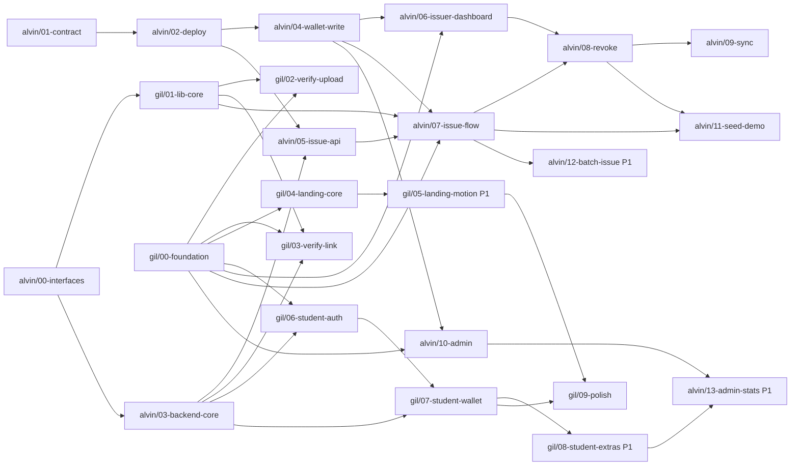

# Workflow: public site, verify and student wallet (Gil)

| | |
|---|---|
| **Integration branch** | `develop` (both devs merge here; released to `main` at each checkpoint) |
| **Gil's sub-branches** | `gil/00-foundation` to `gil/09-polish` (10 branches, section 4) |
| **Owner** | Gil |
| **Reviewer** | Alvin |
| **Pairs with** | `pr-alvin.md` (contract, issuer and admin) |
| **Project** | CampusCred: academic credentials as soulbound records on BNB Smart Chain (testnet), verified in seconds by anyone |
| **Team** | Conexus, Batangas State University |

## 1. Goal and scope

Ship everything a **verifier** and a **student** see, plus the design foundation both devs share:

1. A landing page that sells one idea: check a diploma without calling the registrar.
2. A public verify experience (upload a PDF, or open a share link or QR) that answers **Valid, Revoked, Tampered or Not found** in under 5 seconds, computed from the chain in the verifier's own browser.
3. A student wallet where a student signs in with email and password, downloads their PDF through a 60-second link, and shares each credential by QR code or link.
4. The shared design system (tokens, fonts, app shell, components) that Alvin's issuer and admin screens are built on.

The UI is already designed. These branches turn the prototype into the real Next.js app and connect the verify and student flows to the chain and Supabase.

### Branches at a glance

| Branch | Delivers | Priority | Checkpoint | Depends on |
|---|---|---|---|---|
| `gil/00-foundation` | Tokens, fonts, app shell, shared components, dev showcase | P0 | CP1 | nothing |
| `gil/01-lib-core` | Types, hashing, chain read client, mock chain, `decideResult` | P0 | CP1 | `alvin/00` |
| `gil/02-verify-upload` | `/verify` | P0 | CP2 | `gil/00`, `gil/01` |
| `gil/03-verify-link` | `/v/[slug]`, `GET /api/verify/[slug]` | P0 | CP3 | `gil/00`, `gil/01`, `alvin/03` |
| `gil/04-landing-core` | Landing page, no heavy motion | P0 | CP2 | `gil/00` |
| `gil/05-landing-motion` | Topo background, pinned notes, marquee, scroll effects, cube | P1 | CP5 | `gil/04` |
| `gil/06-student-auth` | `/login`, route guard | P0 | CP4 | `gil/00`, `alvin/03` |
| `gil/07-student-wallet` | `/student`, download link, share sheet with QR | P0 | CP4 | `gil/06`, `alvin/03` |
| `gil/08-student-extras` | Sign up, visibility toggle, verify log, QR scan | P1 | CP5 | `gil/07` |
| `gil/09-polish` | 360px and accessibility pass, placeholders, docs | P0 | CP5 | `gil/04`, `gil/07` |

**In scope:** the branches above, the routes and paths Gil owns in 3.3 and 3.4, and real QR codes (replacing the prototype's sample pattern).

**Out of scope (do not build):**

- Smart contract, wallet connection, issuing, revoking, admin: all in `pr-alvin.md`.
- Integration with the real student information system, mainnet, real student records.
- Student wallet claiming or ERC-5192 tokens, re-issue (FR-15, FR-16): future work.
- OCR and batch issue (FR-11, FR-14): Alvin's P1.

## 2. Branching workflow

Nobody works on one long branch. Work is cut into **small sub-branches** (one topic each) that merge into a shared `develop` branch, and `develop` is released to `main` at each checkpoint. This keeps both devs unblocked and every review small.

### 2.1 Branch model

```
main                          demo-ready, protected. Only release PRs merge here.
 └── develop                  integration branch. Every sub-branch merges here.
      │
      ├── gil/00-foundation          alvin/00-interfaces
      ├── gil/01-lib-core            alvin/01-contract
      ├── gil/02-verify-upload       alvin/02-deploy
      ├── gil/03-verify-link         alvin/03-backend-core
      ├── gil/04-landing-core        alvin/04-wallet-write
      ├── gil/05-landing-motion      alvin/05-issue-api
      ├── gil/06-student-auth        alvin/06-issuer-dashboard
      ├── gil/07-student-wallet      alvin/07-issue-flow
      ├── gil/08-student-extras      alvin/08-revoke
      └── gil/09-polish              alvin/09-sync
                                     alvin/10-admin
                                     alvin/11-seed-demo
                                     alvin/12-batch-issue      (P1)
                                     alvin/13-admin-stats      (P1)
```

| Branch | Purpose | Who merges | How |
|---|---|---|---|
| `main` | What is deployed for the demo. Always works. | Release PR only | Merge commit, then tag (`cp2`, `cp3`, `cp4`, `demo`) |
| `develop` | Integration. The latest work from both devs. | Sub-branch PRs | **Squash merge**, branch deleted after |
| `gil/NN-slug`, `alvin/NN-slug` | One task each, cut from `develop` | The owner, after approval | Opened as a PR into `develop` |
| `hotfix/slug` | Urgent fix after the freeze | Either dev | PR into `main`, then merge `main` back into `develop` |

Rules:

- **No direct pushes** to `main` or `develop`. Turn on branch protection: PR required, one approval, checks must pass.
- **Sub-branch = one topic and a few hours of work.** Aim for under about 400 changed lines, not counting generated files (`bun.lock`, the exported ABI).
- **Name:** `<dev>/<NN>-<slug>`. `NN` is the order in your list. Never reuse a number. The branch cards in section 4 are the master list.
- **Base:** `develop`, unless a card says it is stacked on another branch (see 2.3).
- **Review:** the *other* dev approves. Gil reviews visuals, copy and accessibility. Alvin reviews contract, security and data. Review within the same checkpoint; if a review blocks you for more than 30 minutes, ping in chat.
- **Checks before you ask for review:** `bun run lint`, `bunx tsc --noEmit`, `bun test`, `bun run build`. Contract branches also run `npx hardhat test` inside `hardhat/`.
- **Commits:** small, one topic, clear message (`feat(verify): ...`, `fix(shell): ...`, `chore(ci): ...`). They are squashed on merge, so the PR title becomes the final message: write it well.
- **Draft early.** Open the PR as a Draft on your first push so the other dev can see progress.

### 2.2 Day-to-day commands

```bash
# 1. Start a sub-branch from the latest develop
git switch develop && git pull
git switch -c gil/02-verify-upload

# 2. Work, commit small, push, open a Draft PR into develop
git push -u origin gil/02-verify-upload
gh pr create --base develop --draft --title "feat(verify): upload verify page"   # or use the GitHub UI

# 3. Keep it current: rebase on develop, do not merge develop into your branch
git fetch origin && git rebase origin/develop
#    bun.lock conflict? take develop's file and regenerate it:
git checkout origin/develop -- bun.lock && bun install && git add bun.lock && git rebase --continue

# 4. When green: mark ready, get the other dev's approval, squash merge, delete the branch
git switch develop && git pull && git branch -d gil/02-verify-upload
```

### 2.3 When you depend on a branch that is not merged yet

Pick the first option that works:

1. **Use the stub.** The seams in 3.4 all ship with a working stub or mock (`USE_MOCK_CHAIN`, config placeholders). Build against those.
2. **Wait.** If the dependency is small and due soon (the graph in 2.4 shows what is next), do another card meanwhile.
3. **Stack on it.** Cut your branch from theirs and set your PR's base to theirs. When theirs is squash-merged, move yours onto `develop`:

```bash
git switch -c alvin/07-issue-flow gil/00-foundation        # stacked on an unmerged branch
# ... later, after gil/00-foundation is squash-merged into develop:
git fetch origin
git rebase --onto origin/develop gil/00-foundation alvin/07-issue-flow
git push --force-with-lease
# then change the PR base from gil/00-foundation to develop
```

Never edit the other dev's files to get unblocked (3.3). Ask them, or use a stub.

### 2.4 Dependency graph

An arrow means "must be merged into `develop` first". Green-field branches with no incoming arrow can start immediately.



### 2.5 Merge schedule by checkpoint

How many hours the on-site build lasts is still an open question. Treat checkpoints as ordered milestones and cut from the bottom if time runs short. **Phases 1 to 4 alone make a full demo.**

| # | Milestone | Merge into `develop` | Release to `main` | What works after |
|---|---|---|---|---|
| CP0 | Kickoff (15 min) | Create `develop`, turn on branch protection | | Branches exist, both devs have read this doc |
| CP1 | Seams exist | `alvin/00-interfaces`, `gil/00-foundation`, `gil/01-lib-core` | | Both devs can build against stubs and shared components |
| CP2 | **Contract is live** | `alvin/01-contract`, `alvin/02-deploy`, `alvin/03-backend-core`, `gil/02-verify-upload`, `gil/04-landing-core` | `release: cp2` (tag `cp2`) | Real chain reads. Gil sets `NEXT_PUBLIC_USE_MOCK_CHAIN=false`. A hand-issued credential verifies. |
| CP3 | Issue to verify | `alvin/04`, `05`, `06`, `07`, `gil/03-verify-link` | `release: cp3` | A credential issued in the app shows a real Valid on `/v/[slug]` |
| CP4 | Revoke and student wallet | `alvin/08-revoke`, `alvin/09-sync`, `gil/06-student-auth`, `gil/07-student-wallet` | `release: cp4` | Revoke shows Revoked at once. Students see credentials with a QR. |
| CP5 | **Freeze** | `alvin/10-admin`, `alvin/11-seed-demo`, `gil/09-polish`, plus P1 branches that are ready (`gil/05`, `gil/08`, `alvin/12`, `alvin/13`) | `release: demo` (tag `demo`) | Demo script runs end to end. After this, only `hotfix/*`. |

Cut line, from the bottom: `alvin/13`, `alvin/12`, `gil/08`, `gil/05`, then `alvin/10` stays (issuer admin is P0), `alvin/09` can be replaced by manual sync calls. Do **not** cut `alvin/01` to `alvin/08` or `gil/00` to `gil/04`.

### 2.6 Release PRs (`develop` to `main`)

- Title `release: cpN`. The dev who owns most of that checkpoint opens it; the other approves.
- Before merging: `bun run build` passes on `develop`, and the checkpoint's "what works" line in 2.5 has been tried by hand on the preview deployment.
- Merge with a **merge commit** (not squash), then tag `cpN`. Vercel deploys `main`.
- Add a pull request template with these headings (`alvin/00-interfaces` adds `.github/pull_request_template.md`): **Branch card** (e.g. `gil/02`), **What changed**, **Screenshots (desktop and 360px)** for UI, **How I tested it**, **Checklist** (checks pass, no secrets, `.env.example` updated, placeholders marked).

### 2.7 Definition of done for any sub-branch

- [ ] Every item in the branch card's **Scope** is checked, or moved to a later card with a note
- [ ] The card's **Done when** line is true and you can show it
- [ ] `bun run lint`, `bunx tsc --noEmit`, `bun test`, `bun run build` pass (and `npx hardhat test` for contract branches)
- [ ] No secrets, salt or private keys in the diff or the client bundle
- [ ] `.env.example` updated if you added a variable
- [ ] UI branches: screenshots at desktop and 360px, keyboard focus visible, status never colour alone, `prefers-reduced-motion` respected
- [ ] You only touched files you own (3.3)
- [ ] The other dev approved; the branch is deleted after the squash merge

## 3. Shared agreements (identical in both PR docs)

Gil and Alvin work in parallel. Everything in this section is the contract between the two PRs. If you need to change it, tell the other dev first and update **both** docs.

### 3.1 Who builds what

| Area | Gil | Alvin |
|---|---|---|
| Design foundation (tokens, fonts, shell, shared components) | Owns | Uses |
| Landing page `/` | Owns | |
| Verify by upload `/verify`, verify by link or QR `/v/[slug]` | Owns | |
| Student login, sign up, wallet `/student` | Owns | |
| Browser hashing, chain **read** client, result decision logic | Owns | |
| Smart contract, tests, deployment, ABI export | | Owns |
| Supabase schema, RLS, storage bucket, seed data | | Owns |
| Wallet connection (MetaMask), chain **write** helpers | | Owns |
| Issuer dashboard, issue flow, credential detail and revoke | | Owns |
| Admin page (issuers, pause, stats) | | Owns |
| Issuer and admin API routes, event sync | | Owns |
| Student and public verify API routes | Owns | |

### 3.2 Repo facts that will bite you

- **Read `AGENTS.md` first.** This is Next.js 16.4 with React 19.3 and the App Router only. APIs differ from older Next.js. Read the relevant guide in `node_modules/next/dist/docs/` before writing Next-specific code (routing, caching, route handlers, cookies).
- `next.config.ts` sets `cacheComponents: true`, so rendering is **dynamic by default** and `"use cache"` is opt-in. Anything that reads cookies, headers or the wallet must be a client component or sit behind `<Suspense>`.
- **Package manager is bun.** Use `bun install`, `bun dev`, `bun run build`, `bun run lint`, `bunx tsc --noEmit`. Never commit `package-lock.json` or `yarn.lock`.
- **Tailwind v4, CSS-first.** Tokens live in `app/globals.css` under `@theme inline`. There is no `tailwind.config` and no `postcss.config`; do not add either.
- shadcn is the `base-nova` style, which is built on **Base UI** (`@base-ui/react`), not Radix. Add components with `bunx shadcn add <name>`.
- No test runner is configured. Use **`bun test`** (built in, no config) for unit tests of pure functions. Contract tests use Hardhat.
- Path alias `@/*` maps to the repo root. The Hardhat project lives in `hardhat/` and is excluded from the root `tsconfig.json`.
- The UI prototype is the visual source of truth: https://claude.ai/artifact/48bvH6qfLBRCSESAyucHjL (Design canvas, 6 screens plus the landing page). Match it; do not redesign. All names, numbers, QR codes, the contract address, the domain and the seminar name in the prototype are **sample data or placeholders**.

### 3.3 Path ownership

Do not edit files in the other dev's paths. Open an issue or ask in chat instead.

| Path | Owner |
|---|---|
| `app/globals.css`, `app/layout.tsx`, `components/ui/**`, `components/brand/**`, `components/shell/**` | Gil |
| `components/landing/**`, `components/verify/**`, `components/student/**` | Gil |
| `app/page.tsx`, `app/verify/**`, `app/v/**`, `app/student/**`, `app/(auth)/**` | Gil |
| `app/api/verify/**`, `app/api/students/**`, `app/api/credentials/[hash]/visibility/**`, `app/api/credentials/[hash]/download-url/**` | Gil |
| `lib/hash.ts`, `lib/format.ts`, `lib/types/**`, `lib/chain/read.ts`, `lib/chain/mock.ts`, `lib/verify/**`, `lib/auth/**` | Gil |
| `app/dev/**` (dev-only component showcase), `docs/FRONTEND.md` | Gil |
| `hardhat/**`, `supabase/**`, `scripts/**`, `.github/**` | Alvin |
| `lib/contract/**`, `lib/chain/write.ts`, `lib/wallet/**`, `lib/supabase/**`, `lib/server/**` | Alvin |
| `components/issuer/**`, `components/admin/**`, `components/wallet/**` | Alvin |
| `app/issuer/**`, `app/admin/**` | Alvin |
| `app/api/credentials/prepare/**`, `app/api/credentials/confirm/**`, `app/api/credentials/batch/**`, `app/api/credentials/[hash]/revoke-confirm/**` | Alvin |
| `app/api/issuers/**`, `app/api/issuer/**`, `app/api/admin/**`, `app/api/sync/**` | Alvin |

**Shared files** (`package.json`, `bun.lock`, `.env.example`, `README.md`, `tsconfig.json`):

- Add dependencies in their own commit with a clear message, then rebase often.
- On a `bun.lock` conflict, take main's version and re-run `bun install`. Never hand-merge it.
- `.env.example` is append-only: each dev adds a block under their own heading.

### 3.4 Interfaces between the two PRs

These files are the seams. The producer ships a working stub early (see 2.4 and 2.5) so the consumer is never blocked.

```ts
// lib/types/credential.ts                                  (gil/01-lib-core)
export type Hex = `0x${string}`;
export type CredType =
  | "CERT_ENROLLMENT" | "CERT_GRADES" | "CERT_COMPLETION"
  | "CERT_GOOD_MORAL" | "CERT_SEMINAR" | "DIPLOMA" | "TRANSCRIPT";
export type RevokeReason = "ISSUED_IN_ERROR" | "WRONG_DETAILS" | "REPLACED" | "FRAUD";
export type VerifyResultKind = "valid" | "revoked" | "tampered" | "not_found";

export interface ChainRecord {
  docHash: Hex;
  status: "none" | "active" | "revoked";
  studentRef: Hex;
  credType: CredType | "UNKNOWN";   // decoded with decodeCredType()
  issuer: Hex;
  issuedAt: number | null;          // unix seconds
  revokedAt: number | null;
  revokeReason: RevokeReason | null; // decoded with decodeReason()
}

// lib/hash.ts                                              (gil/01-lib-core)
export function sha256Hex(file: Blob): Promise<Hex>;  // crypto.subtle, "0x" + 64 hex chars

// lib/chain/read.ts                                        (gil/01-lib-core)
// Read-only provider with fallback RPCs. No wallet needed. Honors NEXT_PUBLIC_USE_MOCK_CHAIN.
export function readChainRecord(docHash: Hex): Promise<ChainRecord>;

// lib/verify/decide-result.ts                              (gil/01-lib-core)
export function decideResult(input: {
  record: ChainRecord;
  openedViaSlug: boolean;
  slugDocHash?: Hex;      // hash stored for the slug (from /api/verify/[slug])
  uploadedDocHash?: Hex;
}): VerifyResultKind;

// lib/contract/config.ts                   (alvin/00-interfaces stub, real address in alvin/02-deploy)
export const CHAIN_ID: 97;
export const CONTRACT_ADDRESS: Hex;       // placeholder until deployed (CP2)
export const RPC_URLS: string[];          // primary + fallback
export const EXPLORER_URL: "https://testnet.bscscan.com";
export const txUrl: (hash: Hex) => string;
// lib/contract/CampusCred.abi.ts           (alvin/00 stub, alvin/02 real)  export const CAMPUSCRED_ABI = [...] as const;
// lib/contract/codes.ts                    (alvin/00-interfaces)  decodeCredType(bytes32), encodeCredType(code),
//                                                    decodeReason(bytes32), encodeReason(code)

// lib/supabase/{browser,server,admin}.ts   (alvin/00-interfaces) clients for @supabase/ssr
// lib/server/student-ref.ts                (alvin/03-backend-core) studentRef(studentNo), server only
```

**HTTP endpoints.** Responses are JSON. Errors are `{ "error": "<code>" }` with a matching status.

| Method and path | Owner | Auth | Request, response |
|---|---|---|---|
| `GET /api/verify/[slug]` | Gil | none | `{ docHash, credType, title, issuerName, issuerWallet, issuedAt, txUrl }`. `404 not_found` if the slug is unknown **or** the credential is not public. Never returns a student name. |
| `POST /api/verify/log` | Gil (P1) | none | `{ docHash, result, method }`. Writes to `verifications`. Stores no IP or personal data. The verify result itself is computed in the browser; this only records it. |
| `GET /api/students/me/credentials` | Gil | student session | `[{ docHash, slug, credType, title, issuerName, issuedAt, status, issueTx, revokeTx?, revokeReason?, isPublic }]` |
| `POST /api/credentials/[hash]/download-url` | Gil | student session | `{ url, expiresAt }`. Signed URL that expires after **60 seconds**. Only the owner can request it. *(Added to the spec: needed for the 60-second download.)* |
| `PATCH /api/credentials/[hash]/visibility` | Gil (P1) | student session | `{ isPublic }` |
| `POST /api/credentials/prepare` | Alvin | wallet signature | multipart: `file`, `studentNo`, `credType`, `title`, `docHash`. Server re-hashes the file and rejects a mismatch. Returns `{ docHash, studentRef, credType32, pdfPath }`. |
| `POST /api/credentials/confirm` | Alvin | wallet signature | `{ docHash, txHash }`. Server reads the receipt and the `CredentialIssued` event before saving. Returns `{ slug, txUrl }`. |
| `POST /api/credentials/[hash]/revoke-confirm` | Alvin | wallet signature | `{ txHash, reason }`. Server verifies the `CredentialRevoked` event. |
| `GET /api/issuer/students?q=` | Alvin | wallet signature | Student search for the issue form. Issuer-only; this is the only place names are returned to a non-owner. *(Added to the spec.)* |
| `GET /api/issuer/credentials` and `GET /api/issuer/credentials/[hash]` | Alvin | wallet signature | The issuing wallet's credentials (admin sees all) with student name and number, and one record. Issuer or admin only. *(Added to the spec: the dashboard and detail page need them.)* |
| `GET /api/issuers` | Alvin | none | `[{ wallet, displayName, active }]` for the verify page |
| `GET /api/admin/stats` | Alvin (P1) | wallet signature (admin) | `{ issued, verified, revoked }` |
| `POST /api/sync` | Alvin | secret header | Mirrors contract events into Supabase. Idempotent. *(Added to the spec: see `alvin/09-sync`.)* |

**Wallet signature auth.** The client signs a message `CampusCred auth\nnonce: <random>\nissued: <ISO time>` with `personal_sign`. It sends the address, message and signature as headers. The server recovers the signer, rejects messages older than 5 minutes, and checks the address holds the needed role. The helper is `lib/server/wallet-auth.ts` (Alvin).

### 3.5 Environment variables

`.env.example` must list all of these. Only `NEXT_PUBLIC_*` values may reach the browser.

| Variable | Used by | Notes |
|---|---|---|
| `NEXT_PUBLIC_SITE_URL` | both | Share links are `${SITE_URL}/v/${slug}` |
| `NEXT_PUBLIC_CHAIN_ID` | both | `97` (BSC Testnet) |
| `NEXT_PUBLIC_RPC_URL_PRIMARY`, `NEXT_PUBLIC_RPC_URL_FALLBACK` | both | Two different public BSC Testnet RPCs |
| `NEXT_PUBLIC_CONTRACT_ADDRESS` | both | Filled at CP2 |
| `NEXT_PUBLIC_USE_MOCK_CHAIN` | Gil | `true` until CP2 |
| `NEXT_PUBLIC_SUPABASE_URL`, `NEXT_PUBLIC_SUPABASE_ANON_KEY` | both | |
| `SUPABASE_SERVICE_ROLE_KEY` | server only | Never in client code |
| `STUDENT_REF_SALT` | server only | **Never** in the frontend bundle or the repo |
| `SYNC_SECRET` | Alvin | Protects `/api/sync` |
| `DEPLOYER_PRIVATE_KEY`, `BSCSCAN_API_KEY` | `hardhat/` only | **Testnet key only. Never a mainnet key.** |

`.env*` stays in `.gitignore`. Share real values over a private channel, not in the PR.

### 3.6 Codes

- **Credential types** (stored on chain as `keccak256(code)`; the UI decodes by lookup in `lib/contract/codes.ts`): `CERT_ENROLLMENT`, `CERT_GRADES`, `CERT_COMPLETION`, `CERT_GOOD_MORAL`, `CERT_SEMINAR`, `DIPLOMA`, `TRANSCRIPT`. The last two are added to the spec's list because the product concept covers diplomas and transcripts. The Supabase `cred_type` column must allow all seven.
- **Revoke reasons** (stored as a `bytes32` short code, decoded back to a string): `ISSUED_IN_ERROR` "Issued in error", `WRONG_DETAILS` "Wrong details", `REPLACED` "Replaced by a corrected credential", `FRAUD` "Fraud".
- **Student reference:** `studentRef = keccak256(toUtf8Bytes(STUDENT_REF_SALT + ":" + studentNo))`. One function, `lib/server/student-ref.ts`, used by `prepare` and by the seed script. Never computed in the browser.
- **Document hash:** SHA-256 over the exact PDF bytes, written as `0x` plus 64 hex characters. It is the contract's mapping key.

### 3.7 Verify result rules

The decision lives in one pure function, `decideResult`, so it is easy to test.

1. **Opened through a share link or QR** (`/v/[slug]`) and a PDF is then uploaded:
   - the uploaded hash is **different** from the slug's stored hash → `tampered`;
   - the hashes are equal → the chain status of that hash decides (`valid` or `revoked`).
2. **Bare upload** on `/verify` (no slug):
   - chain says Revoked → `revoked`; Active → `valid`; None → `not_found`.
   - It can **never** say `tampered`: a hash alone cannot tell an edited file from an unknown one. The Not found message must point the verifier to the QR code or link.
3. An unknown or private slug shows Not found.

*(Clarification of the spec: in a slug context a mismatch is always Tampered, even if the other file happens to be a real credential.)*

### 3.8 Privacy rules (non-negotiable)

- On chain: document hash, salted student reference, credential type, issuer wallet, timestamps, status, revoke reason code. **Nothing else.**
- The verify page and `/api/verify/*` never return a student name, number or email.
- PDFs live in a private Supabase bucket. Downloads use signed URLs that expire after 60 seconds.
- A PDF chosen on the verify page is hashed in the browser and never uploaded.
- Demo data is sample data only: no real student records.

## 4. Gil's sub-branches

Each card is one branch and one PR into `develop`. Do them in order unless the graph in 2.4 lets you start one earlier. Priority: **P0** must work in the on-site demo, **P1** build if time allows. "Artboard" names refer to the prototype canvas. Tokens and component specs are in section 5.

#### `gil/00-foundation`

| | |
|---|---|
| **Depends on** | nothing |
| **Unblocks** | every UI branch, both devs |
| **Priority · checkpoint** | P0 · CP1 (merge first, keep it small) |

Scope:

- [ ] Install `qrcode` and `@types/qrcode` in their own commit
- [ ] Fonts via `next/font/google` (Poppins 500, 600, 700; Inter; Lora). Replace the Geist fonts. Update `metadata` in `app/layout.tsx` (title "CampusCred", a real description)
- [ ] Tokens in `app/globals.css` (5.1). Light theme only: remove the `.dark` block and any dark-mode toggle
- [ ] Shared components (5.2): button variants, card, logo, status pill, hash text with `useScrambleText`, app shell, page banner, pill tabs, drop zone, timeline, QR tile
- [ ] Dev-only showcase route `app/dev/components/page.tsx` that renders every component in every state and calls `notFound()` when `NODE_ENV === "production"`, so Alvin can see what exists

Files: `app/globals.css`, `app/layout.tsx`, `components/ui/**`, `components/brand/**`, `components/shell/**`, `app/dev/**`.
Tests: manual. Showcase page at desktop and 360px; the app shell becomes a compact top bar below 980px.
**Done when:** Alvin can import `AppShell`, `PageBanner`, `Card`, `StatusPill`, `HashText`, `TabsPill`, `DropZone`, `Timeline` and `QrTile`, and `bun run build` passes.

#### `gil/01-lib-core`

| | |
|---|---|
| **Depends on** | `alvin/00-interfaces` (needs `lib/contract/config.ts` and the ABI stub) |
| **Unblocks** | `gil/02`, `gil/03`, `alvin/07` |
| **Priority · checkpoint** | P0 · CP1 |

Scope:

- [ ] Install `ethers@^6` in its own commit
- [ ] `lib/types/credential.ts` exactly as in 3.4
- [ ] `lib/hash.ts`: `sha256Hex(file)` with `crypto.subtle`, returns `0x` plus 64 hex characters
- [ ] `lib/chain/read.ts`: `readChainRecord(docHash)` with a read-only provider, two RPC URLs, 3-second timeout then fall back to the second. Decodes `credType` and `revokeReason` with Alvin's `codes.ts`
- [ ] `lib/chain/mock.ts`: fixtures for three sample hashes (active, revoked, unknown), used when `NEXT_PUBLIC_USE_MOCK_CHAIN=true`
- [ ] `lib/verify/decide-result.ts` implementing 3.7
- [ ] `lib/format.ts`: dates like `5 Nov 2026`, `shortHash`
- [ ] `.env.example` block for the variables you use

Files: `lib/hash.ts`, `lib/types/**`, `lib/chain/read.ts`, `lib/chain/mock.ts`, `lib/verify/**`, `lib/format.ts`.
Tests (`bun test`):

- `sha256Hex`: the bytes `abc` give `0xba7816bf8f01cfea414140de5dae2223b00361a396177a9cb410ff61f20015ad`; changing one byte changes the hash; output is `0x` plus 64 hex characters
- `decideResult`: a table test for every row of 3.7 (bare upload: active, revoked, none; slug context: equal hash and active, equal hash and revoked, different hash, private slug)
- `format`: date formatting and `shortHash`

**Done when:** `bun test` is green and `readChainRecord` returns the mock fixtures with the flag on. After `alvin/02-deploy` merges, with the flag off it returns the hand-issued credential (check this at CP2).

#### `gil/02-verify-upload`

| | |
|---|---|
| **Depends on** | `gil/00`, `gil/01` |
| **Unblocks** | CP2 demo of Not found, Valid and Revoked by upload |
| **Priority · checkpoint** | P0 · CP2 |

Artboard "2 · Verify by upload", route `/verify`.

- [ ] Top nav as in the prototype; yellow banner "Verify a document" with the pinned note "Your file stays on your device."
- [ ] `DropZone` (PDF only). On drop: "Computing fingerprint…" with the scrambling hash, then `sha256Hex`, `readChainRecord`, `decideResult` (bare upload rules, 3.7)
- [ ] Result view: dark banner with status pill, the status word at display size and the message. Valid: "Issued by BatStateU Registrar on 5 Nov 2026." Revoked: "Revoked on 11 Nov 2026. Reason: issued in error." Not found: "This document was not issued through CampusCred, or it was changed." plus the hint to open the QR code or link. Use the real issuer name, dates and decoded reason
- [ ] Issuer name from `GET /api/issuers` matched by wallet (mock it as "BatStateU Registrar" until `alvin/05` lands); show type and issued date
- [ ] Fingerprint card (`HashText`), trust strip ("Checked on BNB Smart Chain. Your file never left this device."), contract address and BscScan link, "Check another file"
- [ ] Chain read plus decision finishes in **under 5 seconds** on campus Wi-Fi (NFR-01)

Files: `app/verify/**`, `components/verify/**`.
Tests: manual on the mock chain: Valid, Revoked and Not found each appear; after CP2, repeat on the real chain; time the check.
**Done when:** AC-6 passes, and a hand-issued credential shows Valid by upload.

#### `gil/03-verify-link`

| | |
|---|---|
| **Depends on** | `gil/00`, `gil/01`; `alvin/03` for real data (build on mock slugs until then) |
| **Unblocks** | AC-3, AC-4, AC-5 |
| **Priority · checkpoint** | P0 · CP3 |

Artboard "3 · Verify by link or QR", route `/v/[slug]`.

- [ ] `GET /api/verify/[slug]`: service-role lookup returning only the safe fields in 3.4. Unknown or private slug returns `404 not_found`. Never returns a student name. Until `alvin/03` lands, read from `lib/verify/mock-slugs.ts` when `USE_MOCK_CHAIN=true`
- [ ] Server component loads the metadata; unknown or private slug shows "No record found" with a "Check a PDF instead" button
- [ ] Client component reads the chain for `docHash` and shows Valid or Revoked on load
- [ ] Title block: status pill, credential title, issuer, type, issued date
- [ ] **Status history** timeline: Issued from `issuedAt`; Revoked on top, with the reason, when revoked
- [ ] **"Got a copy of this document?"** drop zone: hash on device, `decideResult` with `openedViaSlug: true`. A match shows a green "Match" row; a mismatch shows the red **Tampered** block with both short hashes
- [ ] Right column: "Where this stands"; "On the chain" with the fingerprint, the salted student reference and the line "No name, student number or email is stored on the chain."; BscScan transaction and contract links
- [ ] Drop the prototype's "what this link resolves to" switcher (it was a demo control). In mock mode you may keep a `?mock=revoked` override for development only

Files: `app/v/**`, `app/api/verify/[slug]/**`, `components/verify/**`.
Tests: manual. All four results appear; Tampered only after a mismatched upload in a slug context; no student name anywhere.
**Done when:** AC-3 (Valid in under 5 seconds from a QR scan), AC-4 and AC-5 (read side) pass on the real chain.

#### `gil/04-landing-core`

| | |
|---|---|
| **Depends on** | `gil/00` |
| **Unblocks** | `gil/05` |
| **Priority · checkpoint** | P0 · CP2 |

Artboard "1 · Landing", route `/`. This is the first thing judges see. Copy and layout come from the prototype.

- [ ] **Nav:** logo; anchor links "The problem" (`#the-problem`), "Answers" (`#answers`), "How it works" (`#cc-steps`); **Sign up** (outline) to `/signup`; **Verify a document** (black pill) to `/verify`. Hide the anchor links below 980px and Sign up below 560px
- [ ] **Hero:** full-bleed `--cc-yellow`, 1000px tall. Headline "Drop it. / Check it. / Trust it." with staggered indents and a letter-by-letter reveal (a small `LetterReveal` component using CSS; no GSAP needed). Subtext, then **Verify a document** and **Login** (outline, to `/login`)
- [ ] **The problem / The fix:** two statements, static (the scroll-lit effect is `gil/05`)
- [ ] **Four answers, two promises:** black section as a plain list of six rows (the cube is `gil/05`)
- [ ] **Four steps:** Issue, Fingerprint, Share, Verify, static
- [ ] **Closing CTA** and footer
- [ ] Works at 360px with no horizontal scroll; `prefers-reduced-motion` respected

Files: `app/page.tsx`, `components/landing/**`.
Tests: manual at desktop and 360px; keyboard-only; reduced motion.
**Done when:** the full page reads correctly with no motion beyond the headline reveal, and every button goes to its route.

#### `gil/05-landing-motion` (P1)

| | |
|---|---|
| **Depends on** | `gil/04` |
| **Unblocks** | `gil/09` |
| **Priority · checkpoint** | P1 · CP5 |

- [ ] **Topo background:** the live contour map from the Kokonut UI "Topo Background" (MIT) as `components/ui/kokonut-topo-background.tsx`. Source: `@kokonutd/kokonut-topo-background` on 21st.dev. The version the team shared in chat is the reference, and the prototype holds a plain-JS port. Fix imports to `@/lib/utils`, **drop the demo-only `review-theme.css` import**, keep the MIT notice, use ink lines (minor 16% opacity, index lines 38%), pass `className="bg-transparent"` over the yellow. Mark the headline block with the `cc-avoid` class so elevation labels stay clear of it
- [ ] **Pinned notes:** four draggable notes (Valid, Tampered with a grade changed from 1.75 to 1.25, a "Check a PDF" note that types a filename and shows a verdict, Revoked). Pointer events with pointer capture, `touch-action: none`. Left edge at least 560px from the left; at 1100px and below they move to a row under the buttons; the last one or two drop out at 900px and 840px; all hide below 560px. Hide the "Drag the notes around" hint at 1100px and below
- [ ] **Marquee:** black strip at the hero bottom with the credential types; pauses on hover
- [ ] **The problem / The fix:** words light up as you scroll (use scroll position, not per-word observers)
- [ ] **Cube:** the six faces from the "Four answers, two promises" section; auto-rotates, follows the pointer, turns to the hovered or focused row
- [ ] **Steps:** the progress line fills on scroll
- [ ] **Closing CTA:** cursor glow
- [ ] Pause the canvas when off screen; no animation when `prefers-reduced-motion` is set

Files: `components/ui/kokonut-topo-background.tsx`, `components/landing/**`.
Tests: manual. Frame rate on a mid-range phone, reduced-motion pass, notes never cover the Login or Verify buttons at any width.
**Done when:** the landing matches the prototype with all motion on, and the page is still usable with it off.

#### `gil/06-student-auth`

| | |
|---|---|
| **Depends on** | `gil/00`; `alvin/03` (Supabase clients and seeded students) |
| **Unblocks** | `gil/07` |
| **Priority · checkpoint** | P0 · CP4 |

- [ ] `/login`: email and password through Supabase Auth with `@supabase/ssr` and Alvin's `lib/supabase/*`. Success goes to `/student`. A wrong password shows a plain message that says what to do
- [ ] Guard `/student`: no session redirects to `/login`. Sign out returns to `/`
- [ ] `/signup` redirects to `/login` until `gil/08` builds the claim flow
- [ ] Keep sessions in cookies; `cookies()` is async in this Next version, so read the bundled docs first

Files: `app/(auth)/**`, `lib/auth/**` (if needed).
Tests: manual with the seeded demo accounts; wrong password; sign out; direct visit to `/student` while signed out.
**Done when:** a seeded student can sign in and out and cannot see `/student` without a session.

#### `gil/07-student-wallet`

| | |
|---|---|
| **Depends on** | `gil/06`; `alvin/03`. Real data needs a credential from `alvin/07` or `alvin/11` |
| **Unblocks** | AC-2 |
| **Priority · checkpoint** | P0 · CP4 |

Artboard "5 · Student wallet", route `/student`.

- [ ] AppShell with nav "My credentials" and "Verify a document"; identity shows the student's name; footer link "Sign out"
- [ ] `GET /api/students/me/credentials` (RLS-backed, student session)
- [ ] Expandable credential cards: title, type, status pill, chevron. Expanded: issuer, issued date, short fingerprint, and a revoked note when revoked
- [ ] **Download PDF:** `POST /api/credentials/[hash]/download-url` returns a 60-second signed URL; open it and show "PDF ready, expires in 0:59" with a draining bar; offer a new download at 0
- [ ] **Share QR and link:** bottom sheet with a real QR (`QrTile`), the link `${NEXT_PUBLIC_SITE_URL}/v/${slug}`, **Copy link** (shows "Link copied") and **Done**, plus the line "Anyone with this link sees the issuer, type and date. Your name is not shown."
- [ ] Empty state for a student with no credentials: "Your registrar will issue your credentials here."

Files: `app/student/**`, `components/student/**`, `app/api/students/**`, `app/api/credentials/[hash]/download-url/**`.
Tests: manual. A student sees only their own credentials; a second student cannot fetch the first one's download URL; the link stops working after 60 seconds.
**Done when:** AC-2 passes: a credential appears in the student's wallet with a QR code.

#### `gil/08-student-extras` (P1)

| | |
|---|---|
| **Depends on** | `gil/07` |
| **Unblocks** | `alvin/13` (verify log feeds admin stats) |
| **Priority · checkpoint** | P1 · CP5 |

- [ ] `/signup`: a student claims a seeded student record by student number, email and password (FR-09 stays P0 through seeded accounts; this is the real flow)
- [ ] Visibility toggle per credential with `PATCH /api/credentials/[hash]/visibility` (FR-12). A hidden credential shows Not found on public links
- [ ] `POST /api/verify/log` (no IP, no personal data), called by the verify screens
- [ ] Scan a QR code in the page with `html5-qrcode` as a second entry point on `/verify`

Files: `app/(auth)/signup/**`, `app/api/verify/log/**`, `app/api/credentials/[hash]/visibility/**`, `components/verify/**`, `components/student/**`.
Tests: manual. Hidden credential gives Not found; the log row stores no IP.
**Done when:** a student can hide and re-show a credential, and verifications are logged.

#### `gil/09-polish`

| | |
|---|---|
| **Depends on** | `gil/04`, `gil/07` (and `gil/05` if it is in) |
| **Unblocks** | the freeze |
| **Priority · checkpoint** | P0 · CP5 |

- [ ] Every screen usable at **360px** wide (NFR-03)
- [ ] Keyboard focus visible everywhere; icon-only buttons have `aria-label`; status uses words and a dot or icon, never colour alone; body text 4.5:1 (NFR-04)
- [ ] Replace remaining placeholders: contract address, domain, seminar name
- [ ] `docs/FRONTEND.md`: tokens, shell usage, how to switch the mock chain on and off
- [ ] Run the five-minute demo script on the deployed `main`, twice

Files: `docs/FRONTEND.md`, small fixes in `components/**` and `app/**` you own.
Tests: manual checklist above.
**Done when:** the demo path (landing, verify by QR, Tampered, student wallet) runs on 360px and desktop with no console errors.

## 5. Reference: design foundation (built in `gil/00-foundation`)

Alvin's screens are blocked on this, so land `gil/00` early and keep it small. The prototype's CSS values are the source of truth.

### 5.1 Tokens

Map these into `app/globals.css` (`@theme inline` for Tailwind v4 plus the shadcn variables). Light theme only. Remove the `.dark` block and the dark-mode toggle; do not ship a dark mode.

| Token | Value | Use |
|---|---|---|
| `--cc-yellow` | `#F0B90B` | Primary accent, hero, active nav item, highlights |
| `--cc-ink` | `#0B0B0C` | Text, black pill buttons, topo lines |
| `--cc-side` | `#14110A` | App sidebar and page banners |
| `--cc-page` | `#FBF8EC` | App page background |
| `--cc-paper` | `#FBFAF4` | Landing light sections |
| `--cc-butter` | `#FBF4D2` | Drop zones, detail tiles, row hover |
| `--cc-line` | `#EAE3C8` | Card borders |
| `--cc-muted` | `#5F5640` / `#6E6549` | Secondary text |
| `--cc-valid` | `#16A34A` | Valid dot (brighter `#4ADE80` on dark) |
| `--cc-revoked` | `#D97706` | Revoked dot (`#FB923C` on dark) |
| `--cc-tampered` | `#DC2626` | Tampered dot (`#F87171` on dark) |
| `--cc-notfound` | `#6B7280` | Not found dot (`#D4D4D8` on dark) |

- Radii: cards `24px`, banners `28px` to `36px`, buttons and pills `999px`, inputs `14px`.
- Fonts via `next/font/google`: **Poppins** (500, 600, 700) for display with `letter-spacing: -0.045em`, **Inter** for text, **Lora** for the one serif paragraph. Hashes use the system monospace stack. Replace the Geist fonts in `app/layout.tsx`.
- Update `metadata` in `app/layout.tsx` (title "CampusCred", a real description).
- Status is **never colour alone**: every status shows a word and a dot or icon. Body text must be at least 4.5:1 contrast.
- Respect `prefers-reduced-motion`: no entrance, marquee, float or spin animation when it is set.

### 5.2 Shared components (you build, Alvin uses)

| Component | Notes |
|---|---|
| `components/ui/button.tsx` variants | Pill buttons: `ink` (black with yellow text), `yellow`, `outline`. Keep the existing shadcn variants working. |
| `components/ui/card.tsx` | White, `--cc-line` border, 24px radius |
| `components/brand/logo.tsx` | Yellow or black circle with a check mark, plus the "CampusCred" wordmark |
| `components/brand/status-pill.tsx` | White pill, dot plus label. Props: `status: VerifyResultKind \| "active" \| "pending"`. |
| `components/brand/hash-text.tsx` | Mono hash; first 10 characters highlighted in yellow, the rest muted. Optional `scramble` (hash "decrypts" left to right) via `useScrambleText`. |
| `components/shell/app-shell.tsx` | Dark sidebar plus main column. Props: `nav: {href, label, icon}[]`, `identity: {title, subtitle}`, `footerLink: {label, href}`, `children`. Below 980px the sidebar becomes a compact top bar (nav in a row, identity text hidden). Main column `flex: 1 1 560px; min-width: 0`. |
| `components/shell/page-banner.tsx` | Dark rounded banner with a large Poppins title, a subtitle and an optional action slot |
| `components/ui/tabs-pill.tsx` | Segmented control with a sliding black highlight; `aria-pressed` on each button |
| `components/ui/drop-zone.tsx` | Dashed black border on butter; "Choose a PDF" button; accepts `application/pdf` only; keyboard accessible. Used by `/verify`, `/v/[slug]` and Alvin's `/issuer/new`. |
| `components/ui/timeline.tsx` | Vertical status history (dot, title, date, text, connecting line) |
| `components/ui/qr-tile.tsx` | Real QR via the `qrcode` package (SVG), on a white tile |

## 6. Acceptance criteria

These map to the spec's demo checklist. Gil owns the verify and student sides of each.

| # | Given | When | Then | Proven in |
|---|---|---|---|---|
| AC-2 | A credential exists | The student logs in | It appears in their wallet with a QR code | `gil/07` |
| AC-3 | A verifier scans the QR | The page loads | **Valid** shows with issuer, type and date in under 5 seconds | `gil/03` |
| AC-4 | A verifier opened the share link | They upload a PDF with one character changed | **Tampered** shows | `gil/03` |
| AC-5 (read side) | The issuer revoked the credential | A verifier scans the QR again | **Revoked** shows with the reason | `gil/03` with `alvin/08` |
| AC-6 | A random PDF | It is uploaded on `/verify` | **Not found** shows, with the hint to open the QR code or link | `gil/02` |

Also: FR-05, FR-06, FR-07, FR-09, FR-10 (no transfer UI exists), FR-12 (P1), NFR-01, NFR-03, NFR-04.

## 7. Test plan

**Automated (`bun test`)** lives in `gil/01-lib-core`: `sha256Hex`, `decideResult` and `format`. Run them in every branch.

**Manual, on the mock chain (before CP2)**

- [ ] Each of the four results appears from the sample hashes
- [ ] 360px, keyboard-only and reduced-motion passes on landing, verify and student

**Manual, on the real chain (after CP2)**

- [ ] AC-2, AC-3, AC-4, AC-5 (read side) and AC-6 with a credential issued from Alvin's flow
- [ ] Time QR scan to badge on venue Wi-Fi and on a phone hotspot. Target under 5 seconds
- [ ] Block the primary RPC: the fallback RPC still answers
- [ ] Open BscScan for the transaction: no name, student number or email (AC-7, with Alvin)

## 8. Risks and decisions

| Risk or open item | Plan |
|---|---|
| Venue Wi-Fi or the testnet RPC is slow | Two RPC URLs with a 3-second timeout, mobile hotspot, a backup video of the full flow |
| Blocked on Alvin's contract | Mock chain until CP2; the interface is fixed in 3.4 |
| `cacheComponents: true` surprises | Read the bundled Next docs before writing data fetching; keep chain reads in client components |
| Heavy landing animations on low-end phones | `gil/05` is P1 and separate: pause the topo canvas off screen, honor reduced motion, hide notes on small screens, and cut the branch if it hurts |
| QR scan in a dim room | Real `qrcode` output on a white tile with a quiet zone; test on two phones |
| Stacked branches get confusing | Prefer stubs over stacking (2.3); retarget the PR base as soon as the parent merges |

**Decisions made in this doc (change only after telling Alvin)**

1. Gil owns the design foundation and the app shell; Alvin consumes it.
2. Student sign up is P1 (`gil/08`). The P0 demo uses seeded student accounts.
3. In a slug context any hash mismatch is Tampered (3.7).
4. Added endpoints not in the original spec: `download-url`, `issuer/students`, `issuer/credentials`, `sync`, `verify/log`.
5. Two credential types added: `DIPLOMA`, `TRANSCRIPT`.
6. Work is cut into sub-branches that squash-merge into `develop`; `develop` is released to `main` at each checkpoint (section 2).

## 9. Definition of done

Every sub-branch meets 2.7. For Gil's work as a whole:

- [ ] All P0 branches merged; P1 branches either merged or listed in the release notes as cut
- [ ] AC-2 to AC-6 pass on the real chain on the deployed `main`
- [ ] Release PRs `cp2`, `cp3`, `cp4` and `demo` went through with Alvin's approval
- [ ] `.env.example` and `README.md` are current; `docs/FRONTEND.md` exists
- [ ] The five-minute demo script ran twice on `main` without a console error
